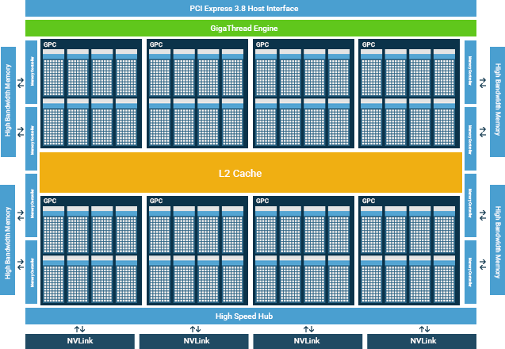
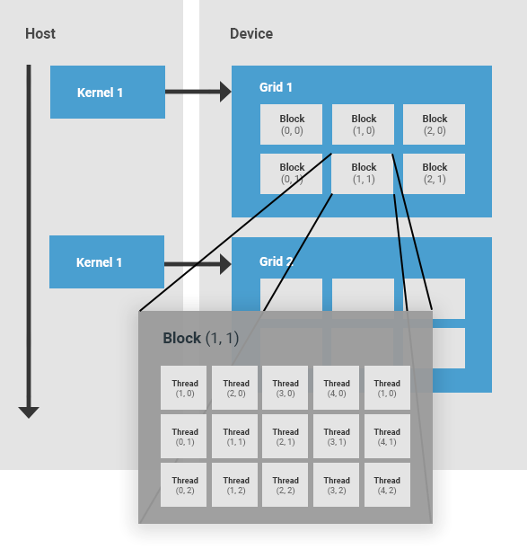
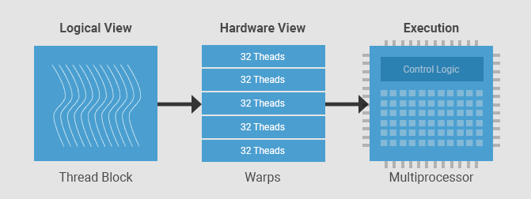
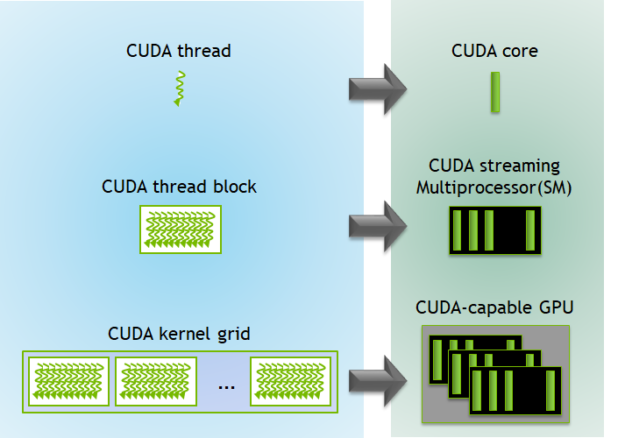
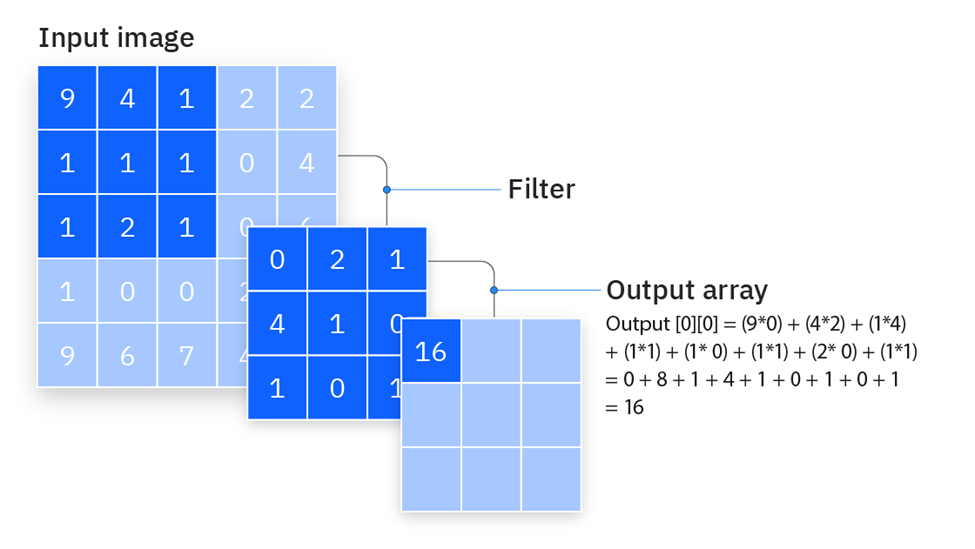
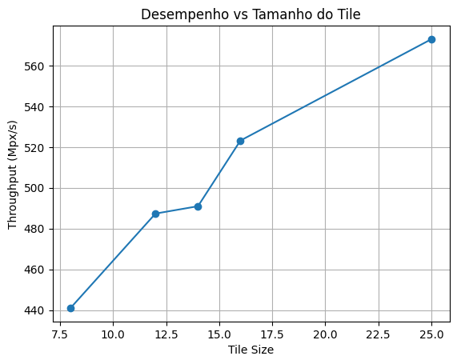

# **Otimização de memória em GPU**

Esta aula é sobre gerenciamento de memória em GPU usando operações de Stencil, estratégias de Tiling com memória compartilhada e agendamento de threads.

## **Organização de hardware em uma GPU NVIDIA**


Uma GPU da NVIDIA tem conjuntos de multiprocessadores chamados **SMs (Streaming Multiprocessors)**. Um SM em uma GPU é responsável pe
la execução de grupos de threads. Quando um grupo de threads é alocado a um SM, ele permanece nesse SM até o fim de sua execução. Cada SM é composto por um conjunto de núcleos, com memória compartilhada, registradores, unidade de load/store e uma unidade de escalonamento.



### **Hierarquia de Threads em CUDA**

A hierarquia de threads em CUDA é composta por uma grade (*grid*) de blocos de threads.

* **Thread block (Bloco de threads):** um bloco de threads é um conjunto de threads que são alocadas no mesmo SM, compartilham os recursos desse SM e cooperam entre si. Cada bloco de threads possui um identificador dentro de sua grid. Um bloco pode ser unidimensional, bidimensional ou tridimensional.

* **Grid:** uma grid é um conjunto de blocos de threads lançado por um kernel, que lê dados da memória global, escreve resultados na memória global e sincroniza dependências entre chamadas de kernels aninhadas. Uma grid é definida pelo usuário e também pode ser unidimensional, bidimensional ou tridimensional.



### **Warp**

Em CUDA, cada grupo de 32 threads consecutivas é chamado de **warp**. Um warp é a unidade primária de execução em um SM. Uma vez que um bloco de threads é alocado a um SM, ele é subdividido em um conjunto de warps para execução. Sempre há um número inteiro de warps por bloco de threads. Uma thread nunca será dividida entre dois warps. Cada SM contém um escalonador de warps responsável por escalonar os warps para os núcleos do SM. 


Fonte: https://developer.codeplay.com/products/computecpp/ce/1.3.0/guides/sycl-for-cuda-developers/execution-model


* **Warps:** grupos de 32 threads que executam em *SIMT* (Single Instruction, Multiple Thread).
* **SM (Streaming Multiprocessor):** executa vários warps alternadamente para amenizar a latência.
* O **agendador de warps** alterna entre os warps prontos para computação.


### Lógica de programação e efeitos no Hardware


Fonte: https://developer.nvidia.com/blog/cuda-refresher-cuda-programming-model/

O lado esquerdo da imagem é a visão do programador. O menor elemento é a *thread CUDA*, que representa uma unidade de execução lógica. Cada thread executa o mesmo código, mas opera sobre dados diferentes. Essas threads são organizadas em *thread blocks*, que são grupos de threads que podem cooperar entre si, compartilhar memória e sincronizar. Vários blocos formam uma *grid*, que corresponde a toda a execução de um kernel.

No lado direito está a correspondência com o hardware. Cada thread não é mapeada diretamente para um único núcleo físico de forma fixa. Em vez disso, threads são executadas em *CUDA cores*, que são as unidades aritméticas da GPU. Os blocos de threads são mapeados para *Streaming Multiprocessors (SMs)*, que são as unidades de execução principais da GPU. Cada SM contém vários CUDA cores, além de registradores e memória compartilhada. Já a grid inteira é distribuída entre vários SMs dentro da GPU.

Uma thread será executada em um CUDA core, mas não de forma exclusiva. Um bloco de threads é atribuído a um único SM, onde suas threads podem compartilhar recursos. Já a grid é distribuída pela GPU inteira, permitindo paralelismo em larga escala.


Implicações práticas:

* Melhor usar **blocos com múltiplos de 32 threads**.
* Evitar **divergência de fluxo** (ifs dentro do warp).
* Maximizar **ocupação**: usar `cudaOccupancyMaxPotentialBlockSize()` ajuda a determinar o tamanho adequado dos blocos.


## Stencil 

Um stencil é um padrão de computação geométrica onde o valor de um elemento é calculado com base em seus vizinhos.

Em operações de stencil, há uma alta reutilização de dados. Cada elemento da entrada é lido múltiplas vezes por diferentes threads que calculam elementos de saída vizinhos, isso é muito utilizado para resolver problemas de convolução, por exemplo.

### Operação de Convolução

A convolução é uma aplicação clássica de stencil. Um "filtro" ou "máscara" desliza sobre a imagem de entrada, realizando uma operação com os pixels vizinhos.



Convolução - Fonte: https://www.ibm.com/think/topics/convolutional-neural-networks

Código base, sem otimizações:

```cpp
#include <iostream>
#include <iomanip>
#include <cmath>
#include <chrono>
#include <cuda_runtime.h>

using namespace std;

const int ITER_LOCAL = 100;

// Cada thread calcula um elemento da saída.
__global__ void heatStencil2D_naive(
    const float* input, float* output,
    int width, int height, float alpha, float dt
) {
    int x = blockIdx.x * blockDim.x + threadIdx.x;
    int y = blockIdx.y * blockDim.y + threadIdx.y;

    if (x >= width || y >= height) return;

    int p = y * width + x;

    float Tij = input[p];
    float Tnew = Tij;

    for (int k = 0; k < ITER_LOCAL; k++) {
        float cima = (y > 0)
            ? input[p - width] : 0.0f;

        float baixo = (y < height - 1)
            ? input[p + width] : 0.0f;

        float esquerda = (x > 0)
            ? input[p - 1] : 0.0f;

        float direita = (x < width - 1)
            ? input[p + 1] : 0.0f;

        float lap = cima + baixo + esquerda + direita - 4.0f * Tij;

        Tnew = Tij + alpha * dt * tanhf(lap);
        Tij = 0.99f * Tnew + 0.01f * sinf(Tnew);
    }

    output[p] = Tnew;
}

int main() {
    const int width = 3840;
    const int height = 2160;
    const int N = width * height;
    const size_t bytes = N * sizeof(float);

    const float alpha = 0.25f;
    const float dt = 0.1f;

    // 1. Reservar memória na CPU.
    // h = host (CPU).
    float* h_input = new float[N];
    float* h_output = new float[N];

    // 2. Inicializar a entrada na CPU.
    for (int p = 0; p < N; p++) {
        h_input[p] = 1.0f;
    }

    // 3. Reservar memória na GPU.
    // d = device (GPU).
    float* d_input = nullptr;
    float* d_output = nullptr;

    cudaMalloc(&d_input, bytes);
    cudaMalloc(&d_output, bytes);

    // 4. Copiar a entrada da CPU para a GPU.
    cudaMemcpy(d_input, h_input, bytes, cudaMemcpyHostToDevice);

    // 5. Organizar as threads em blocos de 16 × 16.
    dim3 threads(16, 16);

    dim3 blocks(
        (width + threads.x - 1) / threads.x,
        (height + threads.y - 1) / threads.y
    );

    // 6. Executar uma vez para aquecer, antes de medir.
    heatStencil2D_naive<<<blocks, threads>>>(
        d_input, d_output, width, height, alpha, dt
    );

    cudaDeviceSynchronize();

    // 7. Medir o tempo de várias execuções.
    const int repeats = 20;

    auto inicio = chrono::steady_clock::now();

    for (int r = 0; r < repeats; r++) {
        heatStencil2D_naive<<<blocks, threads>>>(
            d_input, d_output, width, height, alpha, dt
        );
    }

    // A CPU precisa esperar a GPU terminar antes de parar o relógio.
    cudaDeviceSynchronize();

    auto fim = chrono::steady_clock::now();

    double tempoTotalMs =
        chrono::duration<double, milli>(fim - inicio).count();

    double tempoMedioMs = tempoTotalMs / repeats;

    // 8. Copiar o resultado da GPU para a CPU.
    cudaMemcpy(h_output, d_output, bytes, cudaMemcpyDeviceToHost);

    // 9. Mostrar o tempo e alguns valores da saída.
    double mpxPerSec = (N / 1e6) / (tempoMedioMs / 1000.0);

    cout << "Stencil sem otimizacao (" << width << "x" << height
        << "), " << fixed << setprecision(1)
        << (N / 1e6) << " Mpx\n";

    cout << fixed << setprecision(4);
    cout << "\nTempo medio: " << tempoMedioMs << " ms\n";
    cout << "Throughput: " << mpxPerSec << " Mpx/s\n";
    // 10. Liberar a memória.
    cudaFree(d_input);
    cudaFree(d_output);

    delete[] h_input;
    delete[] h_output;

    return 0;
}
```


Para testar, primeiro carregue o módulo 
```bash
module load cuda/12.8.1
```

Compile com o `nvcc`:

```bash
nvcc base.cu -o base
```

Executando com srun
```bash
srun --partition=merry_gpu --gres=gpu:1 ./base
```

## Vamos aplicar o **Tiling**

*Tiling* é uma técnica de otimização que divide um problema grande em **blocos menores (tiles)** que ocupam de uma foma melhor a memória do hardware. Em vez de processar toda a matriz de uma vez, processamos pedaços menores, reutilizando dados enquanto eles ainda estão em uma memória mais rápida.

A ideia é simples: **trazer um bloco de dados para uma memória mais rápida, usá-lo ao máximo e só depois buscar novos dados**.

Em CPU, o tiling é usado principalmente para **melhorar o uso de cache**.

Na GPU, o conceito é o mesmo, mas a forma de implementação muda bastante.

Aqui, não existe um cache tão transparente quanto na CPU. Em vez disso, temos a **memória compartilhada (shared memory)**, que é muito mais rápida que a memória global.

* Memória lenta → global memory
* Memória rápida → shared memory

Na GPU, o tiling consiste em dividir a matriz em pequenas regiões chamadas *tiles*. Cada bloco de threads fica responsável por uma dessas regiões. As threads cooperam para copiar os dados necessários da memória global para a memória compartilhada (*shared memory*), incluindo os valores vizinhos exigidos pelo cálculo.

Depois do carregamento, as threads do bloco se sincronizam para garantir que todos os dados estejam disponíveis. Em seguida, cada thread calcula seu resultado usando esse dado. Assim, um mesmo valor pode ser aproveitado por várias threads, evitando que cada uma precise buscá-lo novamente na memória global.

O princípio é semelhante ao tiling em CPU: organizar o trabalho em regiões menores e aproveitar os dados enquanto estão próximos das unidades de processamento. Usar posições vizinhas da matriz explora a **localidade espacial**; reutilizar os mesmos valores em cálculos próximos no tempo explora a **localidade temporal**. No nosso kernel, cada bloco carrega um tile, calcula suas saídas e encerra sua execução.


### Aplicando tilling no problema da convolução:

Para aplicar a técnica de tilling neste contexto, é importante planejar a implementação:

* Dividimos a matriz em **tiles** (blocos) que cabem na memória compartilhada.
* Cada bloco carrega seu pedaço + uma margem extra para carregar dados vizinhos.
* Cada *thread block* cuida de um tile.
* *Halo* é o pedaço adicional carregado com os dados vizinhos, para evitar dependência entre blocos.


Aplicando  as otimizações:
```cpp
// otimizado.cu
#include <iostream>
#include <iomanip>
#include <string>
#include <cmath>
#include <chrono>
#include <cuda_runtime.h>

using namespace std;

const int MASK_RADIUS = 1;
const int ITER_LOCAL = 100;

// Stencil com tiling em memória compartilhada.
__global__ void heatStencil2D(
    const float* input, float* output,
    int width, int height,
    float alpha, float dt, int tileSize
) {
    // Memória compartilhada por todas as threads do bloco.
    extern __shared__ float tile[];

    // Lado da região carregada, incluindo o halo.
    int tileExt = tileSize + 2 * MASK_RADIUS;

    // Coordenadas locais da thread.
    int tx = threadIdx.x;
    int ty = threadIdx.y;

    // Coordenadas na matriz de entrada.
    int x = blockIdx.x * tileSize + tx - MASK_RADIUS;
    int y = blockIdx.y * tileSize + ty - MASK_RADIUS;

    // Índice na memória compartilhada.
    int local = ty * tileExt + tx;

    // Cada thread carrega um valor.
    if (x >= 0 && x < width && y >= 0 && y < height) {
        tile[local] = input[y * width + x];
    } else {
        tile[local] = 0.0f;
    }

    //  Esperar todas as threads terminarem o carregamento.
    __syncthreads();

    // Somente as threads internas calculam saídas.
    if (tx >= MASK_RADIUS && tx < tileExt - MASK_RADIUS &&
        ty >= MASK_RADIUS && ty < tileExt - MASK_RADIUS &&
        x >= 0 && x < width && y >= 0 && y < height) {

        float Tij = tile[local];
        float Tnew = Tij;

        for (int k = 0; k < ITER_LOCAL; k++) {
            float cima = tile[local - tileExt];
            float baixo = tile[local + tileExt];
            float esquerda = tile[local - 1];
            float direita = tile[local + 1];

            float lap =
                cima + baixo + esquerda + direita - 4.0f * Tij;

            Tnew = Tij + alpha * dt * tanhf(lap);
            Tij = 0.99f * Tnew + 0.01f * sinf(Tnew);
        }

        //  Escrever o resultado na memória global.
        output[y * width + x] = Tnew;
    }
}

int main() {
    const int width = 3840;
    const int height = 2160;
    const int N = width * height;
    const size_t bytes = N * sizeof(float);

    const float alpha = 0.25f;
    const float dt = 0.1f;

    const int repeats = 20;

    // Tiles de saída. O bloco de threads também inclui o halo.
    int tileSizes[] = {8, 12, 14, 16, 25};
    const int numTests = sizeof(tileSizes) / sizeof(tileSizes[0]);

    //  Reservar memória na CPU.
    float* h_input = new float[N];
    float* h_output = new float[N];

    // Inicializar a entrada.
    for (int p = 0; p < N; p++) {
        h_input[p] = 1.0f;
    }

    // Reservar memória na GPU.
    float* d_input = nullptr;
    float* d_output = nullptr;

    cudaMalloc(&d_input, bytes);
    cudaMalloc(&d_output, bytes);

    // Copiar a entrada da CPU para a GPU.
    cudaMemcpy(d_input, h_input, bytes, cudaMemcpyHostToDevice);

    // Cabeçalho do experimento.
    cout << "\n============================================================\n";
    cout << "STENCIL 2D COM TILING EM MEMORIA COMPARTILHADA\n";
    cout << "------------------------------------------------------------\n";
    cout << " Dimensoes da matriz      : "
         << width << " x " << height << '\n';
    cout << " Total de elementos       : " << N << '\n';
    cout << " Raio do halo             : " << MASK_RADIUS << '\n';
    cout << " Iteracoes locais         : " << ITER_LOCAL << '\n';
    cout << "============================================================\n\n";
    cout << left
         << setw(12) << "Tile"
         << setw(16) << "Threads/Bloco"
         << setw(8)  << "Warps"
         << setw(16) << "Tempo (ms)"
         << setw(16) << "Mpx/s"
         << '\n';

    cout << string(68, '-') << '\n';

    // Testar cada tamanho de tile.
    for (int t = 0; t < numTests; t++) {
        int tileSize = tileSizes[t];

        // Incluir uma margem de halo em cada lado.
        int tileExt = tileSize + 2 * MASK_RADIUS;

        int threadsPerBlock = tileExt * tileExt;
        int warps = (threadsPerBlock + 31) / 32;

        // Uma thread por valor carregado, incluindo o halo.
        dim3 threads(tileExt, tileExt);

        // Cada bloco produz tileSize × tileSize saídas.
        dim3 blocks(
            (width + tileSize - 1) / tileSize,
            (height + tileSize - 1) / tileSize
        );

        // Memória compartilhada reservada por bloco.
        size_t sharedBytes =
            size_t(tileExt) * tileExt * sizeof(float);

        // Executar uma vez para aquecer esta configuração.
        heatStencil2D<<<blocks, threads, sharedBytes>>>(
            d_input, d_output,
            width, height, alpha, dt, tileSize
        );

        cudaDeviceSynchronize();

        // Iniciar a medição no relógio da CPU.
        auto inicio = chrono::steady_clock::now();

        for (int r = 0; r < repeats; r++) {
            heatStencil2D<<<blocks, threads, sharedBytes>>>(
                d_input, d_output,
                width, height, alpha, dt, tileSize
            );
        }

        // Esperar a GPU terminar antes de parar o relógio.
        cudaDeviceSynchronize();

        auto fim = chrono::steady_clock::now();

        double tempoTotalMs =
            chrono::duration<double, milli>(fim - inicio).count();

        double tempoMedioMs = tempoTotalMs / repeats;

        double mpxPerSec =
            (N / 1e6) / (tempoMedioMs / 1000.0);

        // Mostrar uma linha por configuração.
        string tileLabel =
            to_string(tileSize) + "x" + to_string(tileSize);

        cout << left
             << setw(12) << tileLabel
             << setw(16) << threadsPerBlock
             << setw(8)  << warps
             << fixed << setprecision(4)
             << setw(16) << tempoMedioMs
             << fixed << setprecision(2)
             << setw(16) << mpxPerSec
             << '\n';
    }

    cout << string(68, '-') << '\n';

    // Copiar a saída da última configuração para a CPU.
    cudaMemcpy(h_output, d_output, bytes, cudaMemcpyDeviceToHost);

// Liberar a memória da GPU.
    cudaFree(d_input);
    cudaFree(d_output);

    // Liberar a memória da CPU.
    delete[] h_input;
    delete[] h_output;

    return 0;
}
```


Para testar, garanta que o módulo está carregado 
```bash
module load cuda/12.8.1
```

Compile com o `nvcc`:

```bash
nvcc otimizado.cu -o otimo
```

Executando com srun
```bash
srun --partition=merry_gpu --gres=gpu:1 ./otimo
```

Se quiser um slurm:

```
#!/bin/bash
#SBATCH --job-name=GPU
#SBATCH --output=saida.out
#SBATCH --partition=merry_gpu
#SBATCH --nodes=1
#SBATCH --ntasks=1
#SBATCH --gres=gpu:1      -// Aqui pedimos ao SLURM para alocar uma GPU
#SBATCH --time=00:10:00
#SBATCH --mem=4G


echo "========= Executando o Otimizado ==========="
./otimo

```

### Sobre os resultados:

```bash
============================================================
STENCIL 2D COM TILING EM MEMORIA COMPARTILHADA
------------------------------------------------------------
 Dimensoes da matriz      : 3840 x 2160
 Total de elementos       : 8294400
 Raio do halo             : 1
 Iteracoes locais         : 100
------------------------------------------------------------
 Tempo (ms)               : menor eh melhor
 Mpx/s                    : maior eh melhor
============================================================

Tile        Threads/Bloco   Warps   Tempo (ms)      Mpx/s
--------------------------------------------------------------------
8x8         100             4       19.5040         445.27
12x12       196             7       16.9026         490.72
14x14       256             8       16.6329         498.68
16x16       324             11      16.2271         521.14
25x25       729             23      14.3566         577.74
--------------------------------------------------------------------
```



Percebemos como o tamanho do bloco (tile) influencia a eficiência de execução de um kernel em GPU.

Para interpretar a tabela corretamente, é importante observar **três parâmetros principais**:

- Tempo médio (Tempo ms)
- Taxa de processamento (Mpx/s)

O **tempo (ms)** indica quanto cada configuração levou para processar toda a matriz. Valores menores significam execuções mais rápidas, mas devem ser analisados com cuidado: blocos grandes podem reduzir artificialmente o tempo total por utilizarem poucos blocos na GPU, o que mascara o real desempenho paralelo.

O parâmetro mais confiável é o **Mpx/s (milhões de pixels por segundo)**, que mede quantos milhões de elementos foram processados por segundo. Esse valor reflete o **throughput da GPU**, ou seja, quão bem o hardware foi aproveitado. Quanto maior o Mpx/s, mais eficiente foi o uso dos recursos. 

Ao comparar esses valores, percebemos que os blocos menores (8×8, 12×12) apresentam maiores tempos e menores taxas de Mpx/s.

Isso acontece porque há poucas threads por bloco, resultando em **subocupação** da GPU.

Nos blocos intermediários (14×14 a 25×25), o desempenho melhora gradualmente: o tempo diminui, e o Mpx/s aumenta até atingir um ponto em torno do tile de **25×25**, o valor sugerido pelo CUDA. Esse é o ponto de equilíbrio entre paralelismo e uso de memória compartilhada, o bloco é grande o suficiente para gerar alto throughput, mas não tão grande a ponto de limitar a quantidade de blocos ativos por SM.

Já o bloco de 32×32 aparenta ter tempo “zero”, mas isso é um bug de medição: o kernel termina tão rapidamente que o cronômetro perde precisão.
Na prática, blocos muito grandes consomem mais memória compartilhada e reduzem a **ocupação real da GPU**, resultando em menor eficiência, mesmo que o tempo aparente seja baixo.


## Exercícios — Passando Código Sequencial da CPU para GPU com CUDA

A ideia desses exercícios é praticar:

* criação de kernels CUDA;
* paralelismo com threads;
* `cudaMalloc`;
* `cudaMemcpy`;
* configuração de grids e blocos;
* execução de kernels.

### Exercício 1 — Multiplicação de Vetores

Passe a função `multiply` para um kernel CUDA, faça a alocação e a cópia dos dados para a GPU corretamente, e crie o lançador do kernel `multiply`: 

Código base:
```cpp
#include <iostream>

void multiply(int n, float *a, float *b, float *out)
{
    for(int i = 0; i < n; i++)
        out[i] = a[i] * b[i];
}

int main()
{
    int N = 1'000'000;

    float *a   = new float[N];
    float *b   = new float[N];
    float *out = new float[N];

    for(int i = 0; i < N; i++) {
        a[i] = 2.0f;
        b[i] = 4.0f;
    }

    multiply(N, a, b, out);

    std::cout << out[0] << std::endl;

    delete[] a;
    delete[] b;
    delete[] out;
}
```
### Exercício 2 — Soma de Matrizes

Paralelize a soma de matrizes em GPU passando a função `matrixAdd` para um kernel Cuda, faça a alocação, a cópia dos dados para a GPU corretamente, e crie o lançador do kernel.

```cpp 
#include <iostream>

void matrixAdd(int n, float *A, float *B, float *C)
{
    for(int i = 0; i < n*n; i++)
        C[i] = A[i] + B[i];
}

int main()
{
    int N = 1024;

    float *A = new float[N*N];
    float *B = new float[N*N];
    float *C = new float[N*N];

    for(int i = 0; i < N*N; i++) {
        A[i] = 1.0f;
        B[i] = 2.0f;
    }

    matrixAdd(N, A, B, C);

    std::cout << C[0] << std::endl;

    delete[] A;
    delete[] B;
    delete[] C;
}
```

### Exercício 3 — Threshold em Imagem

Paralelize a operação `threshold` em GPU passando a função para um kernel Cuda, faça a alocação, a cópia dos dados para a GPU corretamente, e crie o lançador do kernel.

```cpp 
#include <iostream>

void threshold(unsigned char *in,
               unsigned char *out,
               int n,
               int T)
{
    for(int i = 0; i < n; i++)
    {
        out[i] =
            (in[i] > T) ? 255 : 0;
    }
}

int main()
{
    int N = 1920 * 1080;

    unsigned char *img =
        new unsigned char[N];

    unsigned char *out =
        new unsigned char[N];

    for(int i = 0; i < N; i++)
        img[i] = rand() % 256;

    threshold(img, out, N, 128);

    std::cout << (int)out[0]
              << std::endl;

    delete[] img;
    delete[] out;
}
```

### Exercício 4 — Conversão RGB para Escala de Cinza

Paralelize a operação `rgb2gray` em GPU passando a função para um kernel cuda, faça a alocação, a cópia dos dados para a GPU corretamente, e crie o lançador do kernel.


```cpp 
#include <iostream>

void rgb2gray(unsigned char *rgb,
              unsigned char *gray,
              int n)
{
    for(int i = 0; i < n; i++)
    {
        int idx = i * 3;

        float r = rgb[idx];
        float g = rgb[idx + 1];
        float b = rgb[idx + 2];

        gray[i] =
            0.299f * r +
            0.587f * g +
            0.114f * b;
    }
}

int main()
{
    int N = 1920 * 1080;

    unsigned char *rgb =
        new unsigned char[N * 3];

    unsigned char *gray =
        new unsigned char[N];

    for(int i = 0; i < N*3; i++)
        rgb[i] = rand() % 256;

    rgb2gray(rgb, gray, N);

    std::cout
        << (int)gray[0]
        << std::endl;

    delete[] rgb;
    delete[] gray;
}
```
### Desafio Extra

Depois de terminar os exercícios:

1. compare tempo CPU vs GPU;
2. teste:

   * 128 threads;
   * 256 threads;
   * 512 threads;
3. descubra qual configuração é mais rápida.


Referência:
https://developer.nvidia.com/blog/even-easier-introduction-cuda/