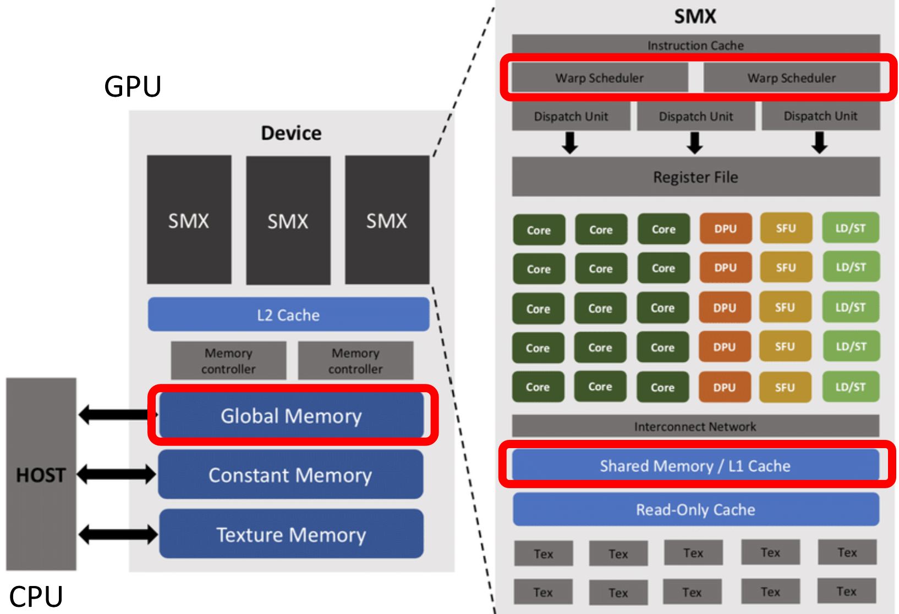
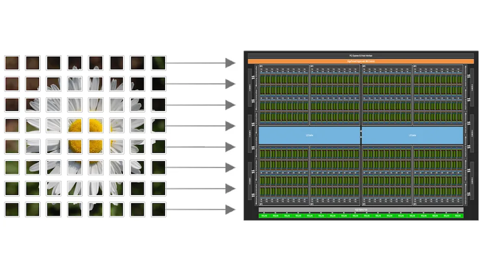
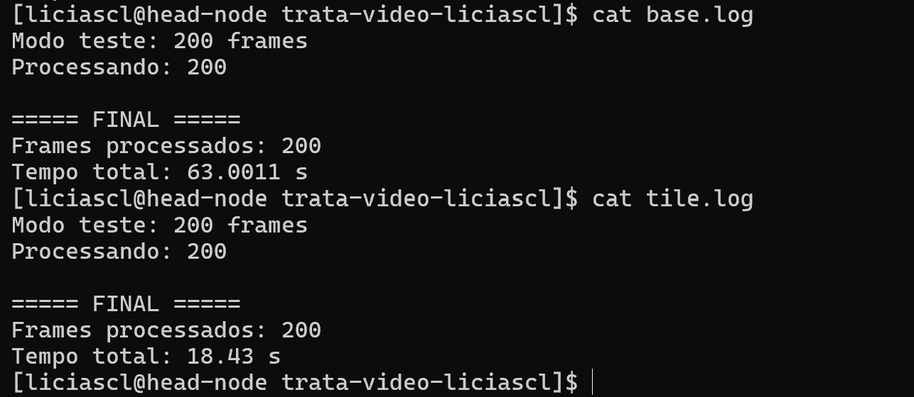
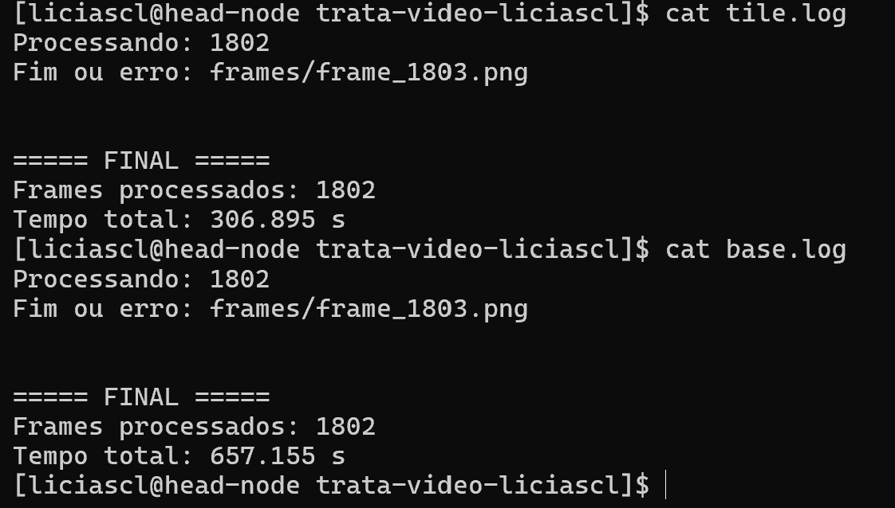

# Revisão - Estratégias de otimização em GPU

Depois de portar um código da CPU para GPU, é importante analisar suas características para identificar qual é o principal gargalo da aplicação. A partir dessa análise, é possível decidir quais técnicas de otimização fazem mais sentido para melhorar o desempenho.

## Em relação aos gargalos

Existem funções com alto reaproveitamento de dados, em que diferentes threads acessam repetidamente os mesmos dados. Um exemplo clássico é o filtro de Sobel em imagens, onde pixels vizinhos são reutilizados várias vezes. Esse tipo de problema se beneficia muito de **tiling** e do uso de **shared memory**, já que os dados podem ser carregados uma vez e reutilizados por múltiplas threads, reduzindo acessos à memória global.

Outro possível gargalo é o **acesso irregular à memória**, que ocorre quando as threads acessam posições distantes entre si, prejudicando a **localidade espacial**. Estruturas como grafos e matrizes esparsas frequentemente apresentam esse problema. Nesses casos, vale reorganizar estruturas de dados para melhorar localidade espacial, utilizar formatos mais compactos e reduzir os acessos desalinhados.


Por fim, um gargalo bastante comum é a **transferência excessiva entre CPU e GPU**. Em alguns casos, mover dados entre host e device pode custar mais caro do que a própria computação. Para reduzir esse impacto, é recomendado minimizar transferências, manter os dados na GPU pelo maior tempo possível, utilizar *pinned memory* e aplicar computação assíncrona com CUDA Streams, permitindo sobreposição entre transferência de dados e execução dos kernels.


## Um novo estudo de caso do código Trata Vídeo

O código base disponibilizado na aula passada realiza, de forma geral, as seguintes etapas:

1. Conversão RGB → grayscale
2. Aplicação do filtro de Sobel
3. Binarização 


Cada uma dessas etapas apresenta características diferentes, permitindo o uso de diferentes técnicas de otimização para melhorar o desempenho.

### Reaproveitamento de Dados 

O filtro de Sobel aplica uma convolução 3x3 sobre a imagem. Isso significa que cada thread acessa não apenas o pixel atual, mas também seus vizinhos. Como pixels vizinhos são reutilizados várias vezes por threads próximas, podemos aplicar **tiling** e **shared memory** para melhorar o reaproveitamento de dados e diminuir o custo de transferência de dados entre Host e Device.

Na implementação original o acesso aos dados ocorre diversas vezes para pixels que poderiam ser reutilizados.

```cpp
int pixel = gray[(y + ky) * w + (x + kx)];
```


Então podemos carregar um bloco da imagem para memória compartilhada e depois reutilizar os pixels entre as threads do bloco.


Com essa otimização, reduzimos acessos à memória global, aumentamos localidade espacial,melhoramos throughput do kernel e reduzimos latência.

No código base, o filtro Sobel é responsável por detectar bordas na imagem através de uma convolução 3x3.

A implementação original faz isso diretamente na memória global:

```cpp
for (int ky = -1; ky <= 1; ky++) {
    for (int kx = -1; kx <= 1; kx++) {

        int pixel =
            gray[(y + ky) * w + (x + kx)];

        sumX += pixel * Gx[ky + 1][kx + 1];
        sumY += pixel * Gy[ky + 1][kx + 1];
    }
}
```


A **Shared Memory** é um tipo de memória extremamente rápida disponível dentro de cada *Streaming Multiprocessor* (SM) da GPU.




Para calcular o valor de um único pixel, cada thread precisa acessar não apenas o pixel central, mas também seus vizinhos. Como threads vizinhas utilizam praticamente os mesmos pixels durante a convolução, muitos acessos acabam sendo repetidos desnecessariamente na memória global.

Para resolver esse problema utilizamos a técnica chamada **tiling**.



O conceito de *tiling* consiste em dividir a imagem em pequenos blocos chamados **tiles**. Cada bloco CUDA fica responsável por carregar uma pequena região da imagem para a Shared Memory. Assim, em vez de cada thread acessar repetidamente a memória global, o bloco inteiro carrega os dados apenas uma vez e depois todas as threads reutilizam esses pixels localmente através da Shared Memory.

Neste exemplo, vamos utilizar blocos de $30 \times 30$

Porém, o Sobel utiliza uma máscara de convolução $3 \times 3$

Isso significa que, para calcular um pixel, também precisamos acessar seus vizinhos, o tile não pode armazenar apenas os pixels centrais do bloco. Também precisamos carregar pixels extras ao redor da região principal para que as threads consigam acessar os vizinhos corretamente durante a convolução.

Essas regiões extras recebem o nome de **Halo**.

Como estamos usando um bloco de $30 \times 30$

e precisamos adicionar uma borda de 1 pixel em cada lado, o tamanho real do tile armazenado na Shared Memory passa a ser:

$$
(30+2) \times (30+2)
$$

O `+2` acontece porque adicionamos:

* 1 coluna extra à esquerda;
* 1 coluna extra à direita;
* 1 linha extra acima;
* 1 linha extra abaixo.

Dentro do kernel CUDA, a Shared Memory é criada utilizando o modificador:

```cpp 
__shared__
```

Por exemplo:

```cpp 
__shared__
unsigned char tile[BLOCK_SIZE + 2][BLOCK_SIZE + 2];
```

Com isso, a GPU passa a armazenar temporariamente os dados do tile em uma memória muito mais rápida e próxima das unidades de execução do SM. Dessa forma, reduzimos drasticamente os acessos à memória global e aumentamos o reaproveitamento de dados entre as threads do bloco.


```cpp
#define BLOCK_SIZE 32

__shared__
unsigned char tile[BLOCK_SIZE][BLOCK_SIZE];
```

Aqui estamos criando:

* uma matriz compartilhada;
* acessível por todas as threads do bloco;
* incluindo espaço para o halo.


Cada thread possui:

```cpp
int tx = threadIdx.x;
int ty = threadIdx.y;
```

Esses índices representam a posição da thread dentro do bloco.

Já a posição global da imagem é:

```cpp
int x =
    blockIdx.x * BLOCK_SIZE + tx;

int y =
    blockIdx.y * BLOCK_SIZE + ty;
```

Cada thread copia um pixel da imagem para o tile:

```cpp
tile[sy][sx] =
    gray[y * w + x];
```

Onde:

```cpp
int sx = tx + 1;
int sy = ty + 1;
```

O deslocamento `+1` existe porque a borda do tile será reservada para o halo.


As threads das bordas ficam responsáveis por carregar pixels extras.


O Sobel passa a acessar:

```cpp
tile[sy + ky][sx + kx]
```

em vez de:

```cpp
gray[(y + ky) * w + (x + kx)]
```

Além do uso de **Shared Memory** e **Tiling**, também precisamos fazer algumas otimizações que ajuda a reduzir a latência, e diminuir acessos à memória global para aumentar o throughput da GPU.


No código original, o processamento era dividido em três etapas separadas:

1. RGB → grayscale
2. Sobel
3. Threshold

Cada etapa percorre a imagem inteira novamente.

Isso gerava múltiplos acessos à memória global:

```txt 
RGB -> grayscale
grayscale -> Sobel
Sobel -> threshold
```

Cada função lê os dados da memória global, processa, e escreve novamente na memória global. Como vimos, essa movimentação de dados de CPU para GPU e de GPU para CPU é muito custosa, uma forma simples de resolver isso é colocar essas funções em um único kernel CUDA:

```txt 
RGB -> grayscale -> Sobel -> threshold
```

Com isso:

* o pixel RGB é carregado apenas uma vez;
* o grayscale já é armazenado diretamente no tile;
* o Sobel utiliza os dados da Shared Memory;
* o threshold é aplicado imediatamente após o Sobel.

Isso reduz drasticamente as leituras globais, as escritas globais, o overhead de múltiplos kernels e as  sincronizações entre CPU e GPU.


As máscaras Sobel são pequenas e utilizadas por todas as threads repetidamente. Na versão original, essas máscaras eram recriadas dentro da função Sobel:

```cpp 
int Gx[3][3]
int Gy[3][3]
```

No kernel otimizado elas foram movidas para:


```cpp 
__constant__ int SOBEL_X[3][3];
```
Isso reduz o overhead de carregamento das máscaras.

Se quiser olhar como ficou o código com as otimizações descritas aqui:

??? note "Ver o código"
        
            // Biblioteca utilizada para carregar imagens PNG/JPG.
            #define STB_IMAGE_IMPLEMENTATION
            #include "stb_image.h"

            // Biblioteca utilizada para salvar imagens.
            #define STB_IMAGE_WRITE_IMPLEMENTATION
            #include "stb_image_write.h"

            // ============================================================
            // BIBLIOTECAS
            // ============================================================

            #include <iostream>
            #include <vector>
            #include <queue>
            #include <cmath>
            #include <cstdio>
            #include <filesystem>
            #include <chrono>
            #include <algorithm>

            // Biblioteca principal do CUDA.
            #include <cuda_runtime.h>

            using namespace std;

            // Alias para facilitar uso do filesystem.
            namespace fs = std::filesystem;

            // Alias para medição de tempo.
            using namespace std::chrono;

            // ============================================================
            // CONFIGURAÇÃO DO BLOCO CUDA
            // ============================================================

            // Define o tamanho do bloco CUDA.
            //
            // Nesse caso:
            // 32 x 32 = 1024 threads por bloco.
            //
            // Cada bloco processará uma região
            // da imagem.
            #define BLOCK_SIZE 32

            // ============================================================
            // ESTRUTURA DE BOUNDING BOX
            // ============================================================

            // Estrutura utilizada para representar
            // caixas delimitadoras.
            struct Box {

                // Coordenadas mínimas e máximas.
                int minx, miny, maxx, maxy;
            };

            // ============================================================
            // MÁSCARAS SOBEL EM CONSTANT MEMORY
            // ============================================================

            // Constant Memory é uma memória otimizada
            // para leitura.
            //
            // Como TODAS as threads usam as mesmas
            // máscaras Sobel, faz sentido armazená-las
            // aqui para reduzir acessos repetidos.

            // Sobel horizontal.
            __constant__ int SOBEL_X[3][3] = {

                {-1, 0, 1},
                {-2, 0, 2},
                {-1, 0, 1}
            };

            // Sobel vertical.
            __constant__ int SOBEL_Y[3][3] = {

                {-1,-2,-1},
                { 0, 0, 0},
                { 1, 2, 1}
            };

            // ============================================================
            // KERNEL CUDA FUSIONADO
            //
            // O kernel realiza:
            //
            // RGB -> Grayscale -> Sobel -> Threshold
            //
            // Tudo em UMA única execução.
            // ============================================================

            __global__
            void pipeline_kernel(

                // Imagem RGB original.
                unsigned char* rgb,

                // Saída binária final.
                unsigned char* bin,

                // Largura da imagem.
                int w,

                // Altura da imagem.
                int h,

                // Valor do threshold.
                int threshold)
            {
                // ========================================================
                // SHARED MEMORY
                // ========================================================

                // Shared Memory utilizada para armazenar
                // um tile da imagem.
                //
                // Shared Memory é MUITO mais rápida
                // que memória global.
                //
                // O tile será reutilizado pelas threads
                // do bloco durante o Sobel.
                __shared__
                unsigned char tile[BLOCK_SIZE][BLOCK_SIZE];

                // ========================================================
                // THREAD IDS
                // ========================================================

                // Posição da thread dentro do bloco.
                int tx = threadIdx.x;
                int ty = threadIdx.y;

                // Coordenada global da thread na imagem.
                int x = blockIdx.x * BLOCK_SIZE + tx;
                int y = blockIdx.y * BLOCK_SIZE + ty;

                // Coordenadas dentro do tile.
                //
                // O +1 existe porque as bordas do tile
                // serão utilizadas pelo halo.
                int sx = tx + 1;
                int sy = ty + 1;

                // ========================================================
                // CARREGAMENTO DO PIXEL CENTRAL
                // ========================================================

                // Verifica se a thread está dentro
                // da imagem.
                if (x < w && y < h)
                {
                    // Índice do pixel RGB.
                    int idx = (y * w + x) * 3;

                    // Carrega canais RGB.
                    unsigned char r = rgb[idx];
                    unsigned char g = rgb[idx + 1];
                    unsigned char b = rgb[idx + 2];

                    // Conversão RGB -> grayscale.
                    //
                    // Fórmula padrão de luminância.
                    tile[sy][sx] =
                        (unsigned char)(
                            0.299f * r +
                            0.587f * g +
                            0.114f * b
                        );
                }

                // ========================================================
                // HALO ESQUERDO
                // ========================================================

                // Threads da primeira coluna carregam
                // pixels extras da esquerda.
                //
                // Esses pixels são necessários para
                // o Sobel 3x3.
                if (tx == 0 && x > 0 && y < h)
                {
                    int idx = (y * w + (x - 1)) * 3;

                    unsigned char r = rgb[idx];
                    unsigned char g = rgb[idx + 1];
                    unsigned char b = rgb[idx + 2];

                    tile[sy][0] =
                        (unsigned char)(
                            0.299f * r +
                            0.587f * g +
                            0.114f * b
                        );
                }

                // ========================================================
                // HALO DIREITO
                // ========================================================

                // Threads da última coluna carregam
                // os pixels da direita.
                if (tx == BLOCK_SIZE - 1 &&
                    x < w - 1 &&
                    y < h)
                {
                    int idx = (y * w + (x + 1)) * 3;

                    unsigned char r = rgb[idx];
                    unsigned char g = rgb[idx + 1];
                    unsigned char b = rgb[idx + 2];

                    tile[sy][BLOCK_SIZE + 1] =
                        (unsigned char)(
                            0.299f * r +
                            0.587f * g +
                            0.114f * b
                        );
                }

                // ========================================================
                // HALO SUPERIOR
                // ========================================================

                // Threads da primeira linha carregam
                // pixels acima.
                if (ty == 0 && y > 0 && x < w)
                {
                    int idx = ((y - 1) * w + x) * 3;

                    unsigned char r = rgb[idx];
                    unsigned char g = rgb[idx + 1];
                    unsigned char b = rgb[idx + 2];

                    tile[0][sx] =
                        (unsigned char)(
                            0.299f * r +
                            0.587f * g +
                            0.114f * b
                        );
                }

                // ========================================================
                // HALO INFERIOR
                // ========================================================

                // Threads da última linha carregam
                // pixels abaixo.
                if (ty == BLOCK_SIZE - 1 &&
                    y < h - 1 &&
                    x < w)
                {
                    int idx = ((y + 1) * w + x) * 3;

                    unsigned char r = rgb[idx];
                    unsigned char g = rgb[idx + 1];
                    unsigned char b = rgb[idx + 2];

                    tile[BLOCK_SIZE + 1][sx] =
                        (unsigned char)(
                            0.299f * r +
                            0.587f * g +
                            0.114f * b
                        );
                }

                // ========================================================
                // HALOS DIAGONAIS
                // ========================================================

                // Também precisamos carregar os
                // cantos diagonais do tile.
                //
                // Isso acontece porque o Sobel usa
                // TODA a vizinhança 3x3.

                // Canto superior esquerdo.
                if (tx == 0 && ty == 0 &&
                    x > 0 && y > 0)
                {
                    int idx =
                        ((y - 1) * w + (x - 1)) * 3;

                    unsigned char r = rgb[idx];
                    unsigned char g = rgb[idx + 1];
                    unsigned char b = rgb[idx + 2];

                    tile[0][0] =
                        (unsigned char)(
                            0.299f * r +
                            0.587f * g +
                            0.114f * b
                        );
                }

                // Canto superior direito.
                if (tx == BLOCK_SIZE - 1 &&
                    ty == 0 &&
                    x < w - 1 &&
                    y > 0)
                {
                    int idx =
                        ((y - 1) * w + (x + 1)) * 3;

                    unsigned char r = rgb[idx];
                    unsigned char g = rgb[idx + 1];
                    unsigned char b = rgb[idx + 2];

                    tile[0][BLOCK_SIZE + 1] =
                        (unsigned char)(
                            0.299f * r +
                            0.587f * g +
                            0.114f * b
                        );
                }

                // Canto inferior esquerdo.
                if (tx == 0 &&
                    ty == BLOCK_SIZE - 1 &&
                    x > 0 &&
                    y < h - 1)
                {
                    int idx =
                        ((y + 1) * w + (x - 1)) * 3;

                    unsigned char r = rgb[idx];
                    unsigned char g = rgb[idx + 1];
                    unsigned char b = rgb[idx + 2];

                    tile[BLOCK_SIZE + 1][0] =
                        (unsigned char)(
                            0.299f * r +
                            0.587f * g +
                            0.114f * b
                        );
                }

                // Canto inferior direito.
                if (tx == BLOCK_SIZE - 1 &&
                    ty == BLOCK_SIZE - 1 &&
                    x < w - 1 &&
                    y < h - 1)
                {
                    int idx =
                        ((y + 1) * w + (x + 1)) * 3;

                    unsigned char r = rgb[idx];
                    unsigned char g = rgb[idx + 1];
                    unsigned char b = rgb[idx + 2];

                    tile[BLOCK_SIZE + 1][BLOCK_SIZE + 1] =
                        (unsigned char)(
                            0.299f * r +
                            0.587f * g +
                            0.114f * b
                        );
                }

                // ========================================================
                // SINCRONIZAÇÃO
                // ========================================================

                // Espera TODAS as threads terminarem
                // de carregar o tile antes do Sobel.
                __syncthreads();

                // ========================================================
                // SOBEL
                // ========================================================

                // Evita processar bordas externas
                // da imagem.
                if (x > 0 &&
                    x < w - 1 &&
                    y > 0 &&
                    y < h - 1)
                {
                    int sumX = 0;
                    int sumY = 0;


                    for (int ky = -1; ky <= 1; ky++)
                    {

                        for (int kx = -1; kx <= 1; kx++)
                        {
                            // Agora acessamos Shared Memory,
                            // NÃO memória global.
                            int pixel =
                                tile[sy + ky][sx + kx];

                            // Convolução horizontal.
                            sumX +=
                                pixel *
                                SOBEL_X[ky + 1][kx + 1];

                            // Convolução vertical.
                            sumY +=
                                pixel *
                                SOBEL_Y[ky + 1][kx + 1];
                        }
                    }


                    int mag =
                        abs(sumX) +
                        abs(sumY);

                    // Limita valor máximo.
                    if (mag > 255)
                        mag = 255;

                    // ====================================================
                    // THRESHOLD
                    // ====================================================

                    // Gera imagem binária.
                    //
                    // Pixels fortes viram branco.
                    // Pixels fracos viram preto.
                    bin[y * w + x] =
                        (mag > threshold)
                        ? 255
                        : 0;
                }
            }

            // ============================================================
            // MAIN
            // ============================================================

            int main(int argc, char* argv[])
            {
                // Quantidade máxima de frames.
                int max_frames = -1;

                // Modo teste via terminal.
                if (argc > 1)
                {
                    max_frames = atoi(argv[1]);

                    cout << "Modo teste: "
                        << max_frames
                        << " frames\n";
                }

                // Cria pasta de saída.
                fs::create_directory("out");

                // Início da medição.
                auto t0 = high_resolution_clock::now();

                int frame = 1;

                // ========================================================
                // LOOP DOS FRAMES
                // ========================================================

                while (true)
                {
                    // Interrompe no modo teste.
                    if (max_frames != -1 &&
                        frame > max_frames)
                        break;

                    char filename[256];

                    // Nome do frame atual.
                    sprintf(
                        filename,
                        "frames/frame_%04d.png",
                        frame
                    );

                    int w, h, c;

                    // Carrega imagem.
                    unsigned char* input =
                        stbi_load(
                            filename,
                            &w,
                            &h,
                            &c,
                            3
                        );

                    // Se não conseguiu carregar,
                    // encerra execução.
                    if (!input)
                    {
                        cout << "\nFim ou erro: "
                            << filename
                            << endl;
                        break;
                    }

                    // ====================================================
                    // MEMÓRIA CPU
                    // ====================================================

                    // Imagem binária final.
                    unsigned char* bin =
                        new unsigned char[w * h];

                    // ====================================================
                    // MEMÓRIA GPU
                    // ====================================================

                    unsigned char* d_rgb;
                    unsigned char* d_bin;

                    // Tamanho da imagem RGB.
                    size_t rgbSize =
                        w * h * 3 *
                        sizeof(unsigned char);

                    // Tamanho da imagem grayscale/binária.
                    size_t graySize =
                        w * h *
                        sizeof(unsigned char);

                    // Aloca memória na GPU.
                    cudaMalloc(&d_rgb, rgbSize);
                    cudaMalloc(&d_bin, graySize);

                    // Copia RGB CPU -> GPU.
                    cudaMemcpy(
                        d_rgb,
                        input,
                        rgbSize,
                        cudaMemcpyHostToDevice
                    );

                    // ====================================================
                    // CONFIGURAÇÃO CUDA
                    // ====================================================

                    // Bloco CUDA.
                    dim3 block(
                        BLOCK_SIZE,
                        BLOCK_SIZE
                    );

                    // Grade CUDA.
                    dim3 grid(
                        (w + BLOCK_SIZE - 1) / BLOCK_SIZE,
                        (h + BLOCK_SIZE - 1) / BLOCK_SIZE
                    );

                    // ====================================================
                    // EXECUÇÃO DO KERNEL
                    // ====================================================

                    pipeline_kernel<<<grid, block>>>(
                        d_rgb,
                        d_bin,
                        w,
                        h,
                        100
                    );

                    // Espera GPU finalizar.
                    cudaDeviceSynchronize();

                    // ====================================================
                    // CÓPIA GPU -> CPU
                    // ====================================================

                    cudaMemcpy(
                        bin,
                        d_bin,
                        graySize,
                        cudaMemcpyDeviceToHost
                    );

                    // ====================================================
                    // OUTPUT
                    // ====================================================

                    char outname[256];

                    sprintf(
                        outname,
                        "out/frame_%04d.png",
                        frame
                    );

                    // Salva imagem binária.
                    stbi_write_png(
                        outname,
                        w,
                        h,
                        1,
                        bin,
                        w * 1
                    );

                    // Mostra progresso.
                    cout << "\rProcessando: "
                        << frame
                        << flush;

                    // ====================================================
                    // LIMPEZA DE MEMÓRIA
                    // ====================================================

                    cudaFree(d_rgb);
                    cudaFree(d_bin);

                    delete[] bin;

                    stbi_image_free(input);

                    frame++;
                }

                // Final da medição.
                auto t1 = high_resolution_clock::now();

                // Tempo total.
                double total_time =
                    duration<double>(t1 - t0).count();

                // ========================================================
                // RESULTADO FINAL
                // ========================================================

                cout << "\n\n===== FINAL =====\n";

                cout << "Frames processados: "
                    << frame - 1
                    << endl;

                cout << "Tempo total: "
                    << total_time
                    << " s\n";

                return 0;
            }
      


Com essas otimizações e ajustes o código com o sobel otimizado teve uma melhora significativa em relação ao base puro:



Na execução com 200 frames, a implementação original levou aproximadamente `63.00 s` enquanto a versão com o sobel otimizado com tile e shared memory executou em cerca de `18.43 s`.



Com 1800 frames o código base levou `657.15s` e a versão com o sobel otimizando com tile e shared memory levou `306.89s`

Aplicamos desta vez apenas a técnica de **tiling com Shared Memory** que consiste em dividir os dados em pequenos blocos reutilizáveis dentro da GPU, reduzindo acessos repetidos à memória global e aumentando o reaproveitamento de dados entre as threads.

Maaaaaaaaaaaaaaaaaasss ainda existem pontos do código que podem ser melhorados, não mexemos nas outras funções e tem técnicas de otimização que podem ser aplicadas para ganhar ainda mais desempenho. 


## Lista de Exercícios para revisão


### Exercício 1 — Convolução 

Otimize a convolução utilizando tiling e shared memory.


### **Rubrica**

| Critério | Descrição | Peso |
|---|---|---|
| **Paralelização em GPU** | Distribui corretamente o cálculo dos pixels entre threads em um grid 2D. | **0.35** |
| **Tiling e shared memory** | Carrega cooperativamente o tile e o halo na memória compartilhada, reutilizando os dados no cálculo. | **0.65** |
| **Total** | | **1.0** |


??? Note "Código base"
    ```cpp 
    #include <iostream>

    using namespace std;

    #define W 2048
    #define H 2048
    #define K 5

    // ============================================================
    // CONVOLUÇÃO 2D
    // ============================================================

    void convolution(
        float* input,
        float* output,
        float kernel[K][K],
        int w,
        int h)
    {
        int radius = K / 2;

        for (int y = radius; y < h - radius; y++)
        {
            for (int x = radius; x < w - radius; x++)
            {
                float sum = 0.0f;

                // Janela do kernel
                for (int ky = -radius; ky <= radius; ky++)
                {
                    for (int kx = -radius; kx <= radius; kx++)
                    {
                        float pixel =
                            input[(y + ky) * w + (x + kx)];

                        float weight =
                            kernel[ky + radius][kx + radius];

                        sum += pixel * weight;
                    }
                }

                output[y * w + x] = sum;
            }
        }
    }

    // ============================================================
    // MAIN
    // ============================================================

    int main()
    {
        float* input =
            new float[W * H];

        float* output =
            new float[W * H];

        float kernel[K][K];

        // Inicializa imagem
        for (int i = 0; i < W * H; i++)
        {
            input[i] = 1.0f;
        }

        // Inicializa kernel
        for (int y = 0; y < K; y++)
        {
            for (int x = 0; x < K; x++)
            {
                kernel[y][x] = 1.0f / (K * K);
            }
        }

        convolution(input, output, kernel, W, H);

        cout << "Convolucao concluida.\n";
        cout << "Resultado: " << output[2 * W + 2] << endl;
        delete[] input;
        delete[] output;

        return 0;
    }
    ```

??? Note "Gabarito"
    ```cpp
    #include <iostream>
    #include <cuda_runtime.h>

    using namespace std;

    #define W 2048
    #define H 2048
    #define K 5

    #define BLOCK_SIZE 16
    #define RADIUS (K / 2)

    // O tile inclui a região do bloco e os vizinhos necessários.
    // Para bloco 16 x 16 e filtro 5 x 5: tile 20 x 20.
    #define TILE_SIZE (BLOCK_SIZE + 2 * RADIUS)

    // ============================================================
    // CONVOLUÇÃO COM TILING E SHARED MEMORY
    // ============================================================

    __global__ void convolution_tiled(
        const float* input,
        float* output,
        const float* kernel,
        int w,
        int h)
    {
        // Cada bloco possui seu próprio tile compartilhado.
        __shared__ float tile[TILE_SIZE][TILE_SIZE];

        int tx = threadIdx.x;
        int ty = threadIdx.y;

        // Coordenada inicial da região de saída deste bloco.
        int block_x = blockIdx.x * BLOCK_SIZE;
        int block_y = blockIdx.y * BLOCK_SIZE;

        // ========================================================
        // CARREGAMENTO COOPERATIVO DO TILE E DO HALO
        // ========================================================

        // Existem 256 threads e 400 posições no tile.
        // Os laços permitem que alguns threads carreguem
        // mais de uma posição, incluindo o halo.
        for (int sy = ty; sy < TILE_SIZE; sy += BLOCK_SIZE) {
            for (int sx = tx; sx < TILE_SIZE; sx += BLOCK_SIZE) {

                // Deslocamento de RADIUS para incluir os vizinhos
                // anteriores ao início da região de saída.
                int gx = block_x + sx - RADIUS;
                int gy = block_y + sy - RADIUS;

                if (gx >= 0 && gx < w && gy >= 0 && gy < h) {
                    tile[sy][sx] = input[gy * w + gx];
                } else {
                    tile[sy][sx] = 0.0f;
                }
            }
        }

        // Todos precisam concluir o carregamento antes de usar
        // pixels que podem ter sido carregados por outros threads.
        __syncthreads();

        // ========================================================
        // CÁLCULO DA CONVOLUÇÃO
        // ========================================================

        // Cada thread calcula um pixel de saída.
        int x = block_x + tx;
        int y = block_y + ty;

        // O retorno ocorre depois da sincronização.
        if (x >= w || y >= h)
            return;

        // Calculamos somente onde a janela cabe inteira,
        // como no código base. A borda é definida como zero,
        // pois no original ela ficava sem inicialização.
        if (x < RADIUS || x >= w - RADIUS ||
            y < RADIUS || y >= h - RADIUS) {
            output[y * w + x] = 0.0f;
            return;
        }

        float sum = 0.0f;

        // Os pixels da janela agora são lidos da shared memory.
        // O centro está em tile[ty + RADIUS][tx + RADIUS],
        // portanto a janela começa em tile[ty][tx].
        for (int ky = 0; ky < K; ky++) {
            for (int kx = 0; kx < K; kx++) {

                float pixel = tile[ty + ky][tx + kx];
                float weight = kernel[ky * K + kx];

                sum += pixel * weight;
            }
        }

        output[y * w + x] = sum;
    }

    // ============================================================
    // MAIN
    // ============================================================

    int main()
    {
        // ========================================================
        // ALOCAÇÃO E INICIALIZAÇÃO NA CPU
        // ========================================================

        float* input = new float[W * H];
        float* output = new float[W * H];

        float kernel[K][K];

        for (int i = 0; i < W * H; i++) {
            input[i] = 1.0f;
        }

        for (int y = 0; y < K; y++) {
            for (int x = 0; x < K; x++) {
                kernel[y][x] = 1.0f / (K * K);
            }
        }

        size_t bytes = size_t(W) * H * sizeof(float);

        // ========================================================
        // ALOCAÇÃO NA GPU
        // ========================================================

        float* d_input;
        float* d_output;
        float* d_kernel;

        cudaMalloc(&d_input, bytes);
        cudaMalloc(&d_output, bytes);
        cudaMalloc(&d_kernel, K * K * sizeof(float));

        // ========================================================
        // TRANSFERÊNCIA CPU → GPU
        // ========================================================

        cudaMemcpy(
            d_input, input, bytes,
            cudaMemcpyHostToDevice);

        cudaMemcpy(
            d_kernel, kernel, K * K * sizeof(float),
            cudaMemcpyHostToDevice);

        // ========================================================
        // CONFIGURAÇÃO DOS BLOCOS E DO GRID
        // ========================================================

        dim3 threads(BLOCK_SIZE, BLOCK_SIZE);

        dim3 blocos(
            (W + BLOCK_SIZE - 1) / BLOCK_SIZE,
            (H + BLOCK_SIZE - 1) / BLOCK_SIZE);

        // ========================================================
        // MEDIÇÃO DO TEMPO DO KERNEL
        // ========================================================

        cudaEvent_t start, stop;

        cudaEventCreate(&start);
        cudaEventCreate(&stop);

        cudaEventRecord(start);

        convolution_tiled<<<blocos, threads>>>(
            d_input, d_output, d_kernel, W, H);

        cudaEventRecord(stop);

        // Espera o kernel terminar antes de continuar.
        cudaDeviceSynchronize();

        float tempo_ms;
        cudaEventElapsedTime(&tempo_ms, start, stop);

        // ========================================================
        // TRANSFERÊNCIA GPU → CPU
        // ========================================================

        cudaMemcpy(
            output, d_output, bytes,
            cudaMemcpyDeviceToHost);

        // Como a entrada contém apenas 1 e o filtro calcula
        // uma média, um pixel interior deve ficar próximo de 1.
        cout << "Convolucao concluida.\n";
        cout << "Resultado: " << output[2 * W + 2] << endl;
        cout << "Tempo do kernel: " << tempo_ms << " ms\n";

        // ========================================================
        // LIBERAÇÃO DOS RECURSOS
        // ========================================================

        cudaFree(d_input);
        cudaFree(d_output);
        cudaFree(d_kernel);

        cudaEventDestroy(start);
        cudaEventDestroy(stop);

        delete[] input;
        delete[] output;

        return 0;
    }

    ```


## Exercício 2

Implemente um programa que recebe um vetor de floats e realiza **duas etapas de processamento em GPU**:

1. Calcule o prefix sum (soma cumulativa) de todos os elementos.
   Exemplo: `[2, 1, 3, 4] → [2, 3, 6, 10]`.

2. Use o último elemento (a soma total) para normalizar todos os valores:
   `[2, 3, 6, 10] → [0.2, 0.3, 0.6, 1.0]`.

| Critério                                   | Descrição                                                                                                                                       | Peso     |
| ------------------------------------------ | ----------------------------------------------------------------------------------------------------------------------------------------------- | -------- |
| Compilação sem erros   | O código compila corretamente com `nvcc`.  | **0.2**  |
| Implementação em GPU Síncrona         | Programação paralela em GPU de forma síncrona. | **+0.6** |
| Implementação em GPU Assíncrona        | Utiliza streams, otimiza o uso de CPU e GPU   | **+0.9** |
| Uso correto do Slurm no Cluster Franky |Configurou corretamente o ambiente HPC (via `srun` ou `sbatch`), com parâmetros adequados de GPU. | **+0.3** |
| **Total**                                  |                                                                                                                                                 | **2.0**  |

??? Note "Código base"
    ```cpp
        #include <iostream>
        #include <vector>
        #include <chrono>

        // SCAN + NORMALIZAÇÃO 

        int main() {
            const size_t N = 87654;
            std::vector<float> v(N);
            std::vector<float> prefix(N);

            auto inicio = std::chrono::high_resolution_clock::now();

            // Gera o vetor
            for (size_t i = 0; i < N; ++i)
                v[i] = static_cast<float>((i + 1) * 2);

            // prefix sum
            prefix[0] = v[0];
            for (size_t i = 1; i < N; ++i)
                prefix[i] = prefix[i - 1] + v[i];

            // Normalização
            float total = prefix.back();  // soma total
            for (size_t i = 0; i < N; ++i)
                prefix[i] /= total;

            auto fim = std::chrono::high_resolution_clock::now();
            double tempo = std::chrono::duration<double, std::milli>(fim - inicio).count();

            // RESULTADOS
            std::cout << "\nÚltimos 10 valores do prefix sum:\n[ ";
            for (size_t i = N - 10; i < N; ++i)
                std::cout << prefix[i] * total << " ";
            std::cout << "]\n";

            std::cout << "Últimos 10 valores normalizados:\n[ ";
            for (size_t i = N - 10; i < N; ++i)
                std::cout << prefix[i] << " ";
            std::cout << "]\n";

            std::cout << "\nTempo CPU: " << tempo << " ms\n";
        }

    ```
??? Note "Implementação Síncrona"
    ```cpp
    #include <iostream>
    #include <vector>
    #include <chrono>
    #include <cuda_runtime.h>
    #define THREADS 1024

    __global__ void scan(float *dados, float *somas_blocos, int N) {
        __shared__ float temp[THREADS];
        int tid = threadIdx.x;
        int gid = blockIdx.x * blockDim.x + tid;

        if (gid < N)
            temp[tid] = dados[gid];
        else
            temp[tid] = 0.0f;
        __syncthreads();

        for (int offset = 1; offset < blockDim.x; offset *= 2) {
            int idx = (tid + 1) * offset * 2 - 1;
            if (idx < blockDim.x)
                temp[idx] += temp[idx - offset];
            __syncthreads();
        }

        if (tid == blockDim.x - 1)
            somas_blocos[blockIdx.x] = temp[tid];

        if (tid == blockDim.x - 1)
            temp[tid] = 0.0f;
        __syncthreads();

        for (int offset = blockDim.x / 2; offset > 0; offset /= 2) {
            int idx = (tid + 1) * offset * 2 - 1;
            if (idx < blockDim.x) {
                float t = temp[idx - offset];
                temp[idx - offset] = temp[idx];
                temp[idx] += t;
            }
            __syncthreads();
        }

        if (gid < N)
            dados[gid] = temp[tid];
    }

    __global__ void adicionar_offsets(float *dados, const float *somas_blocos, int N) {
        int gid = blockIdx.x * blockDim.x + threadIdx.x;
        int bloco = blockIdx.x;
        if (gid < N && bloco > 0) {
            float offset = somas_blocos[bloco - 1];
            dados[gid] += offset;
        }
    }

    __global__ void normalizar(float *dados, float total, int N) {
        int gid = blockIdx.x * blockDim.x + threadIdx.x;
        if (gid < N && total != 0.0f)
            dados[gid] /= total;
    }

    int main() {
        const int N = 87654;
        const int threads = 1024;
        const int blocos = (N + threads - 1) / threads;

        std::vector<float> h_v(N);
        for (int i = 0; i < N; ++i)
            h_v[i] = static_cast<float>((i + 1) * 2);

        float *d_v, *d_somas_blocos;
        cudaMalloc(&d_v, N * sizeof(float));
        cudaMalloc(&d_somas_blocos, blocos * sizeof(float));

        cudaMemcpy(d_v, h_v.data(), N * sizeof(float), cudaMemcpyHostToDevice);

        auto inicio = std::chrono::high_resolution_clock::now();

        scan<<<blocos, threads, threads * sizeof(float)>>>(d_v, d_somas_blocos, N);
        cudaDeviceSynchronize();

        if (blocos > 1) {
            scan<<<1, threads, threads * sizeof(float)>>>(d_somas_blocos, d_somas_blocos, blocos);
            cudaDeviceSynchronize();
            adicionar_offsets<<<blocos, threads>>>(d_v, d_somas_blocos, N);
            cudaDeviceSynchronize();
        }

        float total = 0.0f;
        cudaMemcpy(&total, &d_v[N - 1], sizeof(float), cudaMemcpyDeviceToHost);

        normalizar<<<blocos, threads>>>(d_v, total, N);
        cudaDeviceSynchronize();

        std::vector<float> h_prefix(N);
        cudaMemcpy(h_prefix.data(), d_v, N * sizeof(float), cudaMemcpyDeviceToHost);

        auto fim = std::chrono::high_resolution_clock::now();
        double tempo = std::chrono::duration<double, std::milli>(fim - inicio).count();

        std::cout << "GPU Síncrono \n";
        std::cout << "N = " << N << "\n\n";

        std::cout << "Últimos 10 valores do prefix sum:\n[ ";
        for (int i = N - 10; i < N; ++i)
            std::cout << h_prefix[i] * total << " ";
        std::cout << "]\n";

        std::cout << "Últimos 10 valores normalizados:\n[ ";
        for (int i = N - 10; i < N; ++i)
            std::cout << h_prefix[i] << " ";
        std::cout << "]\n";

        std::cout << "\nSoma total: " << total << "\n";
        std::cout << "Tempo total GPU síncrono: " << tempo << " ms\n";

        cudaFree(d_v);
        cudaFree(d_somas_blocos);
    }
    ```


??? Note "Implementação Assíncrona"
    ```cpp
    #include <iostream>
    #include <vector>
    #include <cuda_runtime.h>

    #define NSTREAMS 2
    #define THREADS  1024

    __global__ void scan(float *dados, float *somas_blocos, int N) {
        __shared__ float temp[THREADS];
        int tid = threadIdx.x;
        int gid = blockIdx.x * blockDim.x + tid;

        if (gid < N) temp[tid] = dados[gid];
        else         temp[tid] = 0.0f;
        __syncthreads();

        for (int offset = 1; offset < blockDim.x; offset <<= 1) {
            int idx = (tid + 1) * (offset << 1) - 1;
            if (idx < blockDim.x) temp[idx] += temp[idx - offset];
            __syncthreads();
        }

        if (tid == blockDim.x - 1) somas_blocos[blockIdx.x] = temp[tid];
        if (tid == blockDim.x - 1) temp[tid] = 0.0f;
        __syncthreads();

        for (int offset = blockDim.x >> 1; offset > 0; offset >>= 1) {
            int idx = (tid + 1) * (offset << 1) - 1;
            if (idx < blockDim.x) {
                float t = temp[idx - offset];
                temp[idx - offset] = temp[idx];
                temp[idx] += t;
            }
            __syncthreads();
        }

        if (gid < N) dados[gid] = temp[tid];
    }

    __global__ void adicionar_offsets(float *dados, const float *somas_blocos, int N) {
        int gid = blockIdx.x * blockDim.x + threadIdx.x;
        int bloco = blockIdx.x;
        if (gid < N && bloco > 0) {
            float offset = somas_blocos[bloco - 1];
            dados[gid] += offset;
        }
    }

    __global__ void add_offset_and_normalize(float *dados, float offset, float total, int N) {
        int gid = blockIdx.x * blockDim.x + threadIdx.x;
        if (gid < N && total != 0.0f) {
            dados[gid] = (dados[gid] + offset) / total;
        }
    }

    static inline float elapsed_ms(cudaEvent_t a, cudaEvent_t b) {
        float ms=0.0f; cudaEventElapsedTime(&ms, a, b); return ms;
    }

    int main() {
        const int N = 987654321;
        const int chunk_elems = (N + NSTREAMS - 1) / NSTREAMS;

        // Host pinned
        float *h_in  = nullptr;
        float *h_out = nullptr;
        cudaMallocHost(&h_in,  N * sizeof(float));
        cudaMallocHost(&h_out, N * sizeof(float));

        for (int i = 0; i < N; ++i) h_in[i] = float((i + 1) * 2); // pares

        // Streams + eventos
        cudaStream_t streams[NSTREAMS];
        for (int i = 0; i < NSTREAMS; ++i) cudaStreamCreate(&streams[i]);
        cudaEvent_t start_total, stop_total;
        cudaEventCreate(&start_total); cudaEventCreate(&stop_total);

        // Buffers por stream
        std::vector<float*> d_chunk(NSTREAMS, nullptr);
        std::vector<float*> d_blockSums(NSTREAMS, nullptr);
        std::vector<int>    len(NSTREAMS, 0);
        std::vector<int>    blocks(NSTREAMS, 0);
        std::vector<float>  chunk_totals(NSTREAMS, 0.0f);

        for (int i = 0; i < NSTREAMS; ++i) {
            int base = i * chunk_elems;
            int L    = std::min(chunk_elems, std::max(0, N - base));
            len[i]   = L;
            blocks[i]= (L + THREADS - 1) / THREADS;
            if (L > 0) {
                cudaMalloc(&d_chunk[i],     L * sizeof(float));
                cudaMalloc(&d_blockSums[i], std::max(1, blocks[i]) * sizeof(float));
            }
        }

        cudaEventRecord(start_total);

        for (int i = 0; i < NSTREAMS; ++i) {
            if (len[i] == 0) continue;
            int base = i * chunk_elems;
            cudaMemcpyAsync(d_chunk[i], h_in + base, len[i]*sizeof(float),
                            cudaMemcpyHostToDevice, streams[i]);

            scan<<<blocks[i], THREADS, 0, streams[i]>>>(d_chunk[i], d_blockSums[i], len[i]);
            if (blocks[i] > 1) {
                scan<<<1, THREADS, 0, streams[i]>>>(d_blockSums[i], d_blockSums[i], blocks[i]);
                adicionar_offsets<<<blocks[i], THREADS, 0, streams[i]>>>(d_chunk[i], d_blockSums[i], len[i]);
            }

            cudaMemcpyAsync(&chunk_totals[i], d_chunk[i] + (len[i]-1), sizeof(float),
                            cudaMemcpyDeviceToHost, streams[i]);
        }

        for (int i = 0; i < NSTREAMS; ++i) cudaStreamSynchronize(streams[i]);

        std::vector<float> chunk_offsets(NSTREAMS, 0.0f);
        float global_total = 0.0f;
        for (int i = 0; i < NSTREAMS; ++i) {
            chunk_offsets[i] = global_total;
            global_total    += chunk_totals[i];
        }

        for (int i = 0; i < NSTREAMS; ++i) {
            if (len[i] == 0) continue;
            add_offset_and_normalize<<<blocks[i], THREADS, 0, streams[i]>>>(
                d_chunk[i], chunk_offsets[i], global_total, len[i]
            );
            int base = i * chunk_elems;
            cudaMemcpyAsync(h_out + base, d_chunk[i], len[i]*sizeof(float),
                            cudaMemcpyDeviceToHost, streams[i]);
        }

        for (int i = 0; i < NSTREAMS; ++i) cudaStreamSynchronize(streams[i]);

        cudaEventRecord(stop_total);
        cudaEventSynchronize(stop_total);
        float tempo_total = elapsed_ms(start_total, stop_total);

        // Resultados (últimos 10)
        std::cout << "GPU Assíncrono (NSTREAMS=" << NSTREAMS << ")\n";
        std::cout << "N = " << N << "\n\n";

        std::cout << "Últimos 10 valores do prefix sum:\n[ ";
        // reconstruir últimos 10 do prefix sum original: h_out está normalizado, então * global_total
        for (int i = N - 10; i < N; ++i) std::cout << h_out[i] * global_total << " ";
        std::cout << "]\n";

        std::cout << "Últimos 10 valores normalizados:\n[ ";
        for (int i = N - 10; i < N; ++i) std::cout << h_out[i] << " ";
        std::cout << "]\n";

        std::cout << "\nSoma total: " << global_total << "\n";
        std::cout << "Tempo total GPU assíncrono: " << tempo_total << " ms\n";

        // Libera
        for (int i = 0; i < NSTREAMS; ++i) {
            if (d_chunk[i])     cudaFree(d_chunk[i]);
            if (d_blockSums[i]) cudaFree(d_blockSums[i]);
            cudaStreamDestroy(streams[i]);
        }
        cudaEventDestroy(start_total);
        cudaEventDestroy(stop_total);
        cudaFreeHost(h_in);
        cudaFreeHost(h_out);
        return 0;
    }

    ```


## **Exercício 3 — Cálculo de PI com Monte Carlo**

O código abaixo implementa o cálculo de PI usando o método de Monte Carlo de forma **sequencial**. Seu objetivo é otimizar esse código para ser realizado de forma síncrona em GPU.

### **Parte 1 - Paralelismo em GPU (1 ponto)**

* **0 pontos** → O aluno **não paralelizou** o código, ou a versão apresentada **não compila/não executa**.
 
* **1 ponto** → O aluno implementou corretamente o cálculo em GPU, utilizando sequências pseudoaleatórias distintas entre threads, combinando as contagens sem conflitos e sincronizando a execução antes de utilizar o resultado na CPU.


### **Parte 2 - Distribuição com MPI (2 pontos)**
Você deve:
    - Distribuir o número total de pontos N entre os processos MPI
    - Cada processo deve calcular sua contagem local de pontos 
    - Utilizar sementes diferentes para o gerador de números aleatórios em cada processo
    - Centralizar as respostas no Rank0 para exibir o valor de PI calculado.

* **0 pontos** → Não implementou MPI ou o código não compila/não executa

* **0.5 ponto** → Implementação incompleta, apresentando problemas como:
    Todos os processos utilizam a mesma seed;
    Problema de distribuição de dados (todos os nós fazem o mesmo trabalho)

* **2 pontos** → Implementação correta, incluindo:
    Distribuição adequada de N entre os processos;
    Uso de seeds independentes por processo;
    Cálculo correto de PI exibido pelo Rank 0 usando o resultado das contas realizadas nos nós de computação

??? Note "Código base"
    ```cpp
    #include <iostream>
    #include <random>
    #include <chrono>
    #include <iomanip>
    using namespace std;

    int main(int argc, char** argv) {
        long long N = (argc > 1 ? atoll(argv[1]) : 100000); // quantidade de pontos

        mt19937 rng(42); // gerador de números aleatórios
        uniform_real_distribution<double> dist(0.0, 1.0);

        long long dentro = 0;

        chrono::high_resolution_clock::time_point t0 = chrono::high_resolution_clock::now();

        // Código sequencial
        for (long long i = 0; i < N; i++) {
            double x = dist(rng);
            double y = dist(rng);
            if (x * x + y * y <= 1.0) {
                dentro++;
            }
        }

        chrono::high_resolution_clock::time_point t1 = chrono::high_resolution_clock::now();

        double pi = 4.0 * (double)dentro / (double)N;
        double tempo = chrono::duration<double>(t1 - t0).count();
        cout << fixed << setprecision(4);
        cout << "N = " << N << "  pi = " << pi << "  tempo = " << tempo << "s" << endl;

        return 0;
    }
    ```

??? Note "Gabarito implementação em GPU"
    ```cpp
    #include <iostream>
    #include <iomanip>
    #include <cstdlib>
    #include <chrono>
    #include <cuda_runtime.h>
    #include <curand_kernel.h>

    using namespace std;

    #define THREADS 256

    // ============================================================
    // MONTE CARLO NA GPU
    // ============================================================

    __global__ void monte_carlo(
        long long N,
        unsigned long long seed,
        unsigned long long* parciais)
    {
        // Uma contagem por thread dentro do bloco.
        __shared__ unsigned long long cache[THREADS];

        int tid = threadIdx.x;

        long long idx =
            (long long)blockIdx.x * blockDim.x + tid;

        long long passo =
            (long long)gridDim.x * blockDim.x;

        // Cada thread possui seu próprio estado.
        // A subsequência idx diferencia os geradores dos threads.
        curandStatePhilox4_32_10_t estado;
        curand_init(seed, (unsigned long long)idx, 0, &estado);

        unsigned long long dentro_local = 0;

        // Grid-stride loop: cada thread pode avaliar vários pontos.
        // Cada índice de ponto é atendido por exatamente um thread.
        for (long long i = idx; i < N; i += passo) {

            // curand_uniform_double retorna valores em (0, 1].
            // A transformação abaixo produz valores em [0, 1).
            double x = 1.0 - curand_uniform_double(&estado);
            double y = 1.0 - curand_uniform_double(&estado);

            if (x * x + y * y <= 1.0) {
                dentro_local++;
            }
        }

        cache[tid] = dentro_local;

        // Todos devem terminar de escrever antes da redução.
        __syncthreads();

        // ========================================================
        // REDUÇÃO DENTRO DO BLOCO
        // ========================================================

        // THREADS é potência de dois, como exige esta redução.
        for (int distancia = blockDim.x / 2;
            distancia > 0;
            distancia /= 2) {

            if (tid < distancia) {
                cache[tid] += cache[tid + distancia];
            }

            __syncthreads();
        }

        // Um único thread grava a soma do bloco.
        // Cada bloco escreve em uma posição diferente.
        if (tid == 0) {
            parciais[blockIdx.x] = cache[0];
        }
    }

    // ============================================================
    // MAIN
    // ============================================================

    int main(int argc, char** argv)
    {
        long long N = 100000;
        unsigned long long seed = 42ULL;

        // Configuração fixa do lançamento.
        // O laço no kernel permite processar todos os N pontos.
        int threads = 256;
        int blocos = 1024;

        // Mede alocações, processamento, transferência e soma final.
        auto t0 = chrono::steady_clock::now();

        unsigned long long* h_parciais =
            new unsigned long long[blocos];

        unsigned long long* d_parciais;

        cudaMalloc(
            &d_parciais,
            blocos * sizeof(unsigned long long));

        // Os pontos são gerados diretamente na GPU.
        // Não é necessário transferir vetores de coordenadas.
        monte_carlo<<<blocos, threads>>>(N, seed, d_parciais);

        // Execução síncrona: aguarda a conclusão da GPU.
        cudaDeviceSynchronize();

        cudaMemcpy(
            h_parciais,
            d_parciais,
            blocos * sizeof(unsigned long long),
            cudaMemcpyDeviceToHost);

        // Combina as contagens dos blocos.
        unsigned long long dentro = 0;

        for (int b = 0; b < blocos; b++) {
            dentro += h_parciais[b];
        }

        double pi = 4.0 * (double)dentro / (double)N;

        auto t1 = chrono::steady_clock::now();

        double tempo =
            chrono::duration<double>(t1 - t0).count();

        cout << fixed << setprecision(8);
        cout << "N = " << N
            << "  pi = " << pi
            << "  tempo = " << tempo << "s\n";

        cudaFree(d_parciais);
        delete[] h_parciais;

        return 0;
    }

    ```

??? Note "Gabarito MPI"
    ```cpp
    #include <iostream>
    #include <random>
    #include <iomanip>
    #include <cstdlib>
    #include <mpi.h>

    using namespace std;

    int main(int argc, char** argv)
    {
        MPI_Init(&argc, &argv);

        int rank;
        int processos;

        MPI_Comm_rank(MPI_COMM_WORLD, &rank);
        MPI_Comm_size(MPI_COMM_WORLD, &processos);

        // ========================================================
        // DEFINIÇÃO DO TOTAL DE PONTOS
        // ========================================================

        long long N = 0;

        if (rank == 0) {
            N = (argc > 1 ? atoll(argv[1]) : 100000);
        }

        // Todos recebem o mesmo total definido pelo rank 0.
        MPI_Bcast(
            &N, 1, MPI_LONG_LONG_INT,
            0, MPI_COMM_WORLD);

        if (N <= 0) {
            if (rank == 0) {
                cerr << "N deve ser positivo.\n";
            }

            MPI_Finalize();
            return 1;
        }

        // ========================================================
        // DISTRIBUIÇÃO DOS PONTOS
        // ========================================================

        long long base = N / processos;
        long long resto = N % processos;

        // Os primeiros 'resto' processos recebem um ponto extra.
        // A soma de todos os N_local é exatamente N.
        long long N_local =
            base + (rank < resto ? 1 : 0);

        // Cada processo usa uma seed diferente.
        unsigned int seed = 42u + (unsigned int)rank;

        mt19937 rng(seed);
        uniform_real_distribution<double> dist(0.0, 1.0);

        long long dentro_local = 0;
        long long dentro_total = 0;

        // Alinha o início da região medida entre os processos.
        MPI_Barrier(MPI_COMM_WORLD);

        double t0 = MPI_Wtime();

        // ========================================================
        // CÁLCULO LOCAL
        // ========================================================

        for (long long i = 0; i < N_local; i++) {
            double x = dist(rng);
            double y = dist(rng);

            if (x * x + y * y <= 1.0) {
                dentro_local++;
            }
        }

        // ========================================================
        // SOMA DAS CONTAGENS NO RANK 0
        // ========================================================

        MPI_Reduce(
            &dentro_local,
            &dentro_total,
            1,
            MPI_LONG_LONG_INT,
            MPI_SUM,
            0,
            MPI_COMM_WORLD);

        double tempo_local = MPI_Wtime() - t0;
        double tempo_total = 0.0;

        // Reporta o maior tempo entre os processos.
        MPI_Reduce(
            &tempo_local,
            &tempo_total,
            1,
            MPI_DOUBLE,
            MPI_MAX,
            0,
            MPI_COMM_WORLD);

        // ========================================================
        // RESULTADO FINAL
        // ========================================================

        if (rank == 0) {
            double pi =
                4.0 * (double)dentro_total / (double)N;

            cout << fixed << setprecision(8);
            cout << "Processos = " << processos
                << "  N = " << N
                << "  pi = " << pi
                << "  tempo = " << tempo_total << "s\n";
        }

        MPI_Finalize();

        return 0;
    }
    ```