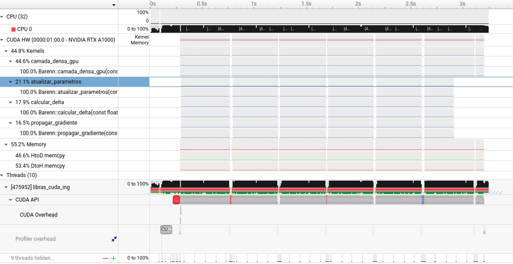
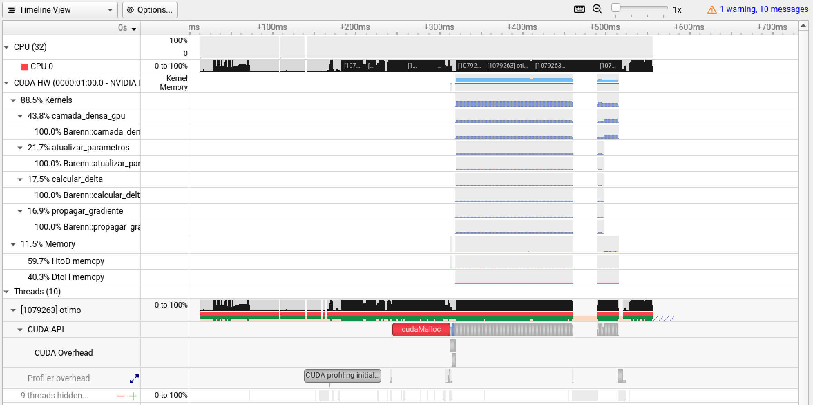
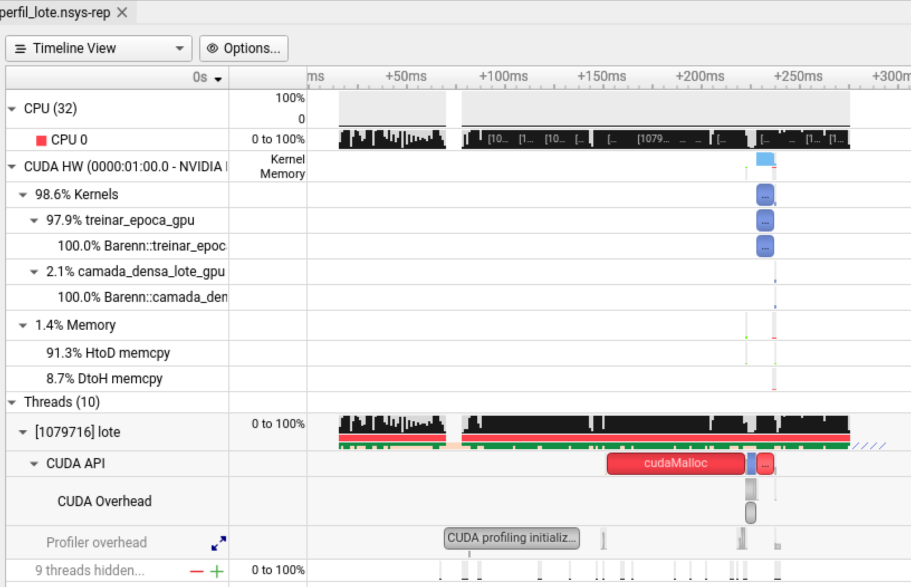

# Profiling de aplicações CPU–GPU

Uma aplicação pode executar um cálculo rapidamente na GPU e ainda assim demorar para entregar o resultado. Entre a entrada e a saída, a CPU prepara os dados, transfere informações para a GPU, lança operações e espera pelos resultados. **Profiling** é observar a execução para descobrir quais dessas etapas concentram o custo. Nesta aula, vamos usar essa evidência para escolher uma otimização e depois medir se ela fez diferença.

O exercício usa uma rede densa que classifica **15 letras do alfabeto manual em Libras** a partir de imagens da mão. Começaremos com uma versão sequencial em C++ e vamos guardar os pesos, as entradas de teste e os escores produzidos pela CPU. Em seguida, compararemos duas versões CUDA da inferência. Na primeira, as threads leem os pesos diretamente da memória global. Na segunda, as threads de um bloco carregam parte dos pesos em memória compartilhada e os reutilizam para processar várias amostras. As três versões usarão o mesmo lote e os mesmos pesos. 

## Ferramentas de profiling da NVIDIA

O **NVIDIA CUDA Toolkit** é o pacote de desenvolvimento para aplicações CUDA. Além do compilador `nvcc` e das bibliotecas CUDA, o pacote inclui ferramentas para investigar desempenho e verificar a execução do código na GPU. Neste laboratório, usaremos **Nsight Systems**, **Nsight Compute** e **Compute Sanitizer**. 

O **Nsight Systems** (`nsys`) mostra **onde e quando a aplicação gasta tempo**. Ele organiza as atividades em uma linha do tempo. Na versão sequencial em C++, podemos coletar amostras de CPU para identificar quais funções concentram o trabalho durante o treino ou a inferência. Quando a aplicação passa a usar CUDA, podemos observar também as transferências entre CPU e GPU, os lançamentos de kernels e os intervalos de espera. Essa visão ajuda a decidir se vale investigar a preparação dos dados, as transferências ou o cálculo na GPU.

O **Nsight Compute** (`ncu`) examina **como um kernel CUDA usa os recursos da GPU**. Depois de identificar um kernel relevante na linha do tempo, podemos coletar métricas sobre seus acessos à memória, o comportamento dos caches e a ocupação. 


Para verificar se as ferramentas estão disponíveis no cluster, utilize os comandos:

Carregue o módulo cuda:

```bash
module load cuda/12.8.1  #no cluster franky
```

As ferramentas:

```bash
nsys --version               # Nsight Systems
ncu --version                # Nsight Compute
```

Deve aparecer algo parecido com isso:

```bash
NVIDIA Nsight Systems version 2024.6.2.225-246235244400v0
NVIDIA (R) Nsight Compute Command Line Profiler
Copyright (c) 2018-2025 NVIDIA Corporation
Version 2025.1.1.0 (build 35528883) (public-release)
```

Para fazer um primeiro teste no código base que está sequecial em CPU, utilize o comando:

```bash
srun --partition=merry_cpu --ntasks=1 --mem=1G /opt/ohpc/pub/libras/base /opt/ohpc/pub/libras/libras_csv
```

A saída deve ser algo parecido com isso:

```bash
Tempo de treino: 2.2276 s
TESTE | 877/878 acertos (99.89%)
Perda media: 0.0084
Tempo de inferencia do lote: 4.1813 ms

Esperado  Previsto
       A         A
       B         B
       C         C
       D         D
       E         E
       I         I
       L         L
       M         M
       N         N
       O         O
       R         R
       S         S
       U         U
       V         V
       W         W
```


| Trecho do comando | O que faz |
|---|---|
| `srun --partition=merry_cpu --ntasks=1 --mem=1G` | Solicita ao Slurm uma tarefa na partição `merry_cpu`, com 1 GB de memória no nó alocado. |
| `/opt/ohpc/pub/libras/base /opt/ohpc/pub/libras/libras_csv` | Executa o binário já compilado e passa o diretorio com as imagens e suas labels como argumento. |


### Profiling da versão CUDA ingênua

Utilize o código exemplo disponível a seguir:

Trechos do código base em CPU foram passados para serem executados em GPU:

```cpp
#include <cuda_runtime.h>

#include <algorithm>
#include <array>
#include <chrono>
#include <cmath>
#include <filesystem>
#include <fstream>
#include <iomanip>
#include <iostream>
#include <random>
#include <sstream>
#include <stdexcept>
#include <string>
#include <string_view>
#include <cctype>
#include <utility>
#include <vector>

using namespace std;

namespace Barenn {

// Cada amostra contém os 64 pixels de uma imagem em escala de cinza de 8 por 8.
constexpr int entradas = 64;
constexpr string_view letras = "ABCDEILMNORSUVW";
constexpr int classes = static_cast<int>(letras.size());

constexpr int oculta1 = 32;
constexpr int oculta2 = 16;

// Cada buffer pertence a uma única chamada de camada. Na próxima versão,
// estes buffers poderão viver na GPU durante todo o treino.
class BufferGpu {
    float* ponteiro = nullptr;
    size_t bytes;

public:
    explicit BufferGpu(size_t elementos) : bytes(elementos * sizeof(float)) {
        if (bytes != 0) {
            const auto erro = cudaMalloc(&ponteiro, bytes);
            if (erro != cudaSuccess) throw runtime_error(cudaGetErrorString(erro));
        }
    }
    ~BufferGpu() { if (ponteiro) cudaFree(ponteiro); }
    BufferGpu(const BufferGpu&) = delete;
    BufferGpu& operator=(const BufferGpu&) = delete;

    float* data() const { return ponteiro; }

    void enviar(const float* origem) const {
        const auto erro = cudaMemcpy(ponteiro, origem, bytes, cudaMemcpyHostToDevice);
        if (erro != cudaSuccess) throw runtime_error(cudaGetErrorString(erro));
    }

    void receber(float* destino) const {
        const auto erro = cudaMemcpy(destino, ponteiro, bytes, cudaMemcpyDeviceToHost);
        if (erro != cudaSuccess) throw runtime_error(cudaGetErrorString(erro));
    }
};

constexpr int bloco = 128;
int grade(int n) { return (n + bloco - 1) / bloco; }

__global__ void camada_densa_gpu(const float* entrada, const float* pesos,
                                const float* vies, int n_entradas, int n_saidas,
                                bool relu, float* saida, float* z) {
    int i = blockIdx.x * blockDim.x + threadIdx.x;
    if (i >= n_saidas) return;
    float soma = vies[i];
    for (int j = 0; j < n_entradas; ++j) {
        soma += entrada[j] * pesos[i * n_entradas + j];
    }
    if (z) z[i] = soma;
    saida[i] = relu && soma < 0.0f ? 0.0f : soma;
}

__global__ void calcular_delta(const float* grad_saida, const float* z,
                               bool relu, int n_saidas, float* delta) {
    int i = blockIdx.x * blockDim.x + threadIdx.x;
    if (i >= n_saidas) return;
    delta[i] = relu ? grad_saida[i] * (z[i] > 0.0f ? 1.0f : 0.0f)
                    : grad_saida[i];
}

__global__ void propagar_gradiente(const float* pesos, const float* delta,
                                   int n_entradas, int n_saidas, float* grad_entrada) {
    int j = blockIdx.x * blockDim.x + threadIdx.x;
    if (j >= n_entradas) return;
    float soma = 0.0f;
    for (int i = 0; i < n_saidas; ++i) {
        soma += delta[i] * pesos[i * n_entradas + j];
    }
    grad_entrada[j] = soma;
}

__global__ void atualizar_parametros(const float* entrada, const float* delta,
                                     int n_entradas, int n_pesos, float taxa,
                                     float* pesos, float* vies) {
    int k = blockIdx.x * blockDim.x + threadIdx.x;
    if (k >= n_pesos) return;
    int i = k / n_entradas;
    int j = k % n_entradas;
    pesos[k] -= taxa * (delta[i] * entrada[j]);
    if (j == 0) vies[i] -= taxa * delta[i];
}

class Camada {
    int n_entradas;
    int n_saidas;
    bool relu;
    vector<float> pesos;
    vector<float> vies;

public:
    Camada(int entradas_camada, int saidas_camada, bool usar_relu)
        : n_entradas(entradas_camada), n_saidas(saidas_camada), relu(usar_relu),
          pesos(n_entradas * n_saidas), vies(n_saidas, 0.0f) {
        mt19937 gerador(1337);
        uniform_real_distribution<float> distribuicao(-0.05f, 0.05f);
        for (float& peso : pesos) peso = distribuicao(gerador);
    }

    void forward(const float* entrada, float* saida, float* z = nullptr) const {
        // Versão ingênua: a CPU envia até os pesos a cada forward de camada.
        BufferGpu d_entrada(n_entradas), d_pesos(pesos.size()), d_vies(n_saidas);
        BufferGpu d_saida(n_saidas), d_z(z ? n_saidas : 0);
        d_entrada.enviar(entrada);
        d_pesos.enviar(pesos.data());
        d_vies.enviar(vies.data());

        camada_densa_gpu<<<grade(n_saidas), bloco>>>(
            d_entrada.data(), d_pesos.data(), d_vies.data(), n_entradas,
            n_saidas, relu, d_saida.data(), d_z.data());
        const auto erro = cudaGetLastError();
        if (erro != cudaSuccess) throw runtime_error(cudaGetErrorString(erro));

        // A cópia síncrona espera pelo kernel. A próxima camada recebe
        // a ativação pelo host e vai copiá-la de volta para a GPU.
        d_saida.receber(saida);
        if (z) d_z.receber(z);
    }

    void backward(const float* entrada, const float* z, const float* grad_saida,
                  float* grad_entrada, float taxa) {
        BufferGpu d_entrada(n_entradas), d_pesos(pesos.size()), d_vies(n_saidas);
        BufferGpu d_grad_saida(n_saidas), d_delta(n_saidas);
        BufferGpu d_z(z ? n_saidas : 0), d_grad_entrada(grad_entrada ? n_entradas : 0);
        d_entrada.enviar(entrada);
        d_pesos.enviar(pesos.data());
        d_vies.enviar(vies.data());
        d_grad_saida.enviar(grad_saida);
        if (z) d_z.enviar(z);

        calcular_delta<<<grade(n_saidas), bloco>>>(
            d_grad_saida.data(), d_z.data(), relu, n_saidas, d_delta.data());
        auto erro = cudaGetLastError();
        if (erro != cudaSuccess) throw runtime_error(cudaGetErrorString(erro));

        // A mesma stream preserva a ordem: o gradiente de entrada usa
        // os pesos antigos, antes que o próximo kernel os atualize.
        if (grad_entrada) {
            propagar_gradiente<<<grade(n_entradas), bloco>>>(
                d_pesos.data(), d_delta.data(), n_entradas, n_saidas,
                d_grad_entrada.data());
            erro = cudaGetLastError();
            if (erro != cudaSuccess) throw runtime_error(cudaGetErrorString(erro));
        }
        const int n_pesos = n_entradas * n_saidas;
        atualizar_parametros<<<grade(n_pesos), bloco>>>(
            d_entrada.data(), d_delta.data(), n_entradas, n_pesos, taxa,
            d_pesos.data(), d_vies.data());
        erro = cudaGetLastError();
        if (erro != cudaSuccess) throw runtime_error(cudaGetErrorString(erro));

        // A CPU mantém a cópia dos parâmetros para a próxima chamada.
        d_pesos.receber(pesos.data());
        d_vies.receber(vies.data());
        if (grad_entrada) d_grad_entrada.receber(grad_entrada);
    }

    void salvar(ostream& arquivo) const {
        for (int i = 0; i < n_saidas; ++i) {
            for (int j = 0; j < n_entradas; ++j) {
                arquivo << pesos[i * n_entradas + j] << ' ';
            }
            arquivo << vies[i] << '\n';
        }
    }
};

// Buffers reutilizáveis de uma amostra. Somente o treino guarda os valores
// anteriores à ReLU e usa os buffers de gradiente.
struct Buffers {
    array<float, oculta1> a1{}, z1{}, grad1{};
    array<float, oculta2> a2{}, z2{}, grad2{};
    array<float, classes> escores{}, grad_perda{};
};

class Rede {
    Camada l1{entradas, oculta1, true};
    Camada l2{oculta1, oculta2, true};
    Camada l3{oculta2, classes, false};

public:
    void forward(const float* entrada, float* escores, Buffers& b,
                 bool treino = false) const {
        l1.forward(entrada, b.a1.data(), treino ? b.z1.data() : nullptr);
        l2.forward(b.a1.data(), b.a2.data(), treino ? b.z2.data() : nullptr);
        l3.forward(b.a2.data(), escores);
    }

    void backward(const float* entrada, Buffers& b, float taxa) {
        l3.backward(b.a2.data(), nullptr, b.grad_perda.data(), b.grad2.data(), taxa);
        l2.backward(b.a1.data(), b.z2.data(), b.grad2.data(), b.grad1.data(), taxa);
        l1.backward(entrada, b.z1.data(), b.grad1.data(), nullptr, taxa);
    }

    void salvar(ostream& arquivo) const {
        l1.salvar(arquivo);
        l2.salvar(arquivo);
        l3.salvar(arquivo);
    }
};

struct Amostra {
    vector<float> atributos;
    int letra;
};

vector<Amostra> ler_letra(const filesystem::path& pasta, int letra) {
    const char nome = letras[letra];
    auto caminho = pasta / (string(1, nome) + ".csv");
    ifstream arquivo(caminho);
    if (!arquivo) {
        caminho = pasta / (string(1, static_cast<char>(tolower(nome))) + ".csv");
        arquivo.open(caminho);
    }
    if (!arquivo) throw runtime_error("CSV ausente para a letra " + string(1, nome));

    vector<Amostra> dados;
    string linha;
    size_t numero = 0;
    while (getline(arquivo, linha)) {
        ++numero;
        if (linha.find_first_not_of(" \t\r") == string::npos) continue;

        istringstream campos(linha);
        Amostra amostra{vector<float>(entradas), letra};
        bool valida = true;
        for (int i = 0; i < entradas; ++i) {
            float& valor = amostra.atributos[i];
            if (!(campos >> valor) || !isfinite(valor)) {
                valida = false;
                break;
            }
            if (i < entradas - 1) {
                char virgula;
                if (!(campos >> virgula) || virgula != ',') {
                    valida = false;
                    break;
                }
            }
        }
        if (!valida || !(campos >> ws).eof()) {
            throw runtime_error(caminho.string() + ":" + to_string(numero) +
                                " — esperados 64 números separados por vírgula");
        }
        dados.push_back(move(amostra));
    }
    if (arquivo.bad() || dados.size() < 2) {
        throw runtime_error("São necessárias ao menos duas amostras em " + caminho.string());
    }
    return dados;
}

struct Normalizacao {
    array<double, entradas> media{};
    array<double, entradas> escala{};

    explicit Normalizacao(const vector<Amostra>& treino) {
        // Ajusta a normalização somente com os dados de treino.
        for (const auto& amostra : treino) {
            for (int i = 0; i < entradas; ++i) media[i] += amostra.atributos[i];
        }
        for (double& valor : media) valor /= treino.size();
        for (const auto& amostra : treino) {
            for (int i = 0; i < entradas; ++i) {
                const double desvio = amostra.atributos[i] - media[i];
                escala[i] += desvio * desvio;
            }
        }
        for (double& valor : escala) valor = max(1e-6, sqrt(valor / treino.size()));
    }

    void aplicar(vector<Amostra>& dados) const {
        for (auto& amostra : dados) {
            for (int i = 0; i < entradas; ++i) {
                amostra.atributos[i] = static_cast<float>(
                    (amostra.atributos[i] - media[i]) / escala[i]);
            }
        }
    }
};

float perda(const float* escores, int letra, float* grad = nullptr) {
    float total = 0;
    for (int i = 0; i < classes; ++i) {
        const float erro = escores[i] - (i == letra ? 1.0f : 0.0f);
        total += 0.5f * erro * erro;
        if (grad) grad[i] = erro;
    }
    return total;
}

} // namespace Barenn

int main(int argc, char** argv) {
    using namespace Barenn;
    if (argc < 2 || argc > 4) {
        cerr << "Uso: " << argv[0] << " pasta_dos_csvs [saida_gpu.txt|-] [epocas]\n";
        return 1;
    }

    try {
        mt19937 gerador(1337);
        vector<Amostra> treino, teste;
        for (int letra = 0; letra < classes; ++letra) {
            auto dados = ler_letra(argv[1], letra);
            shuffle(dados.begin(), dados.end(), gerador);
            // Reserva cerca de 20% de cada letra, com pelo menos uma amostra.
            const size_t n_teste = max<size_t>(1, dados.size() / 5);
            for (size_t i = 0; i < dados.size(); ++i) {
                auto& destino = i < n_teste ? teste : treino;
                destino.push_back(move(dados[i]));
            }
        }
        const Normalizacao normalizacao(treino);
        normalizacao.aplicar(treino);
        normalizacao.aplicar(teste);

        size_t caracteres = 0;
        const int epocas = argc == 4 ? stoi(argv[3], &caracteres) : 51;
        if (epocas <= 0 || (argc == 4 && argv[3][caracteres] != '\0')) {
            throw runtime_error("Informe um número inteiro positivo de épocas.");
        }
        constexpr float taxa = 0.02f;
        Rede rede;
        Buffers buffers;
        vector<double> perdas(epocas);

        const auto inicio_treino = chrono::steady_clock::now();
        for (int epoca = 0; epoca < epocas; ++epoca) {
            shuffle(treino.begin(), treino.end(), gerador);
            for (const auto& amostra : treino) {
                const float* entrada = amostra.atributos.data();
                rede.forward(entrada, buffers.escores.data(), buffers, true);
                perdas[epoca] += perda(buffers.escores.data(), amostra.letra,
                                       buffers.grad_perda.data());
                rede.backward(entrada, buffers, taxa);
            }
            perdas[epoca] /= treino.size();
            if (!isfinite(perdas[epoca])) throw runtime_error("Treino divergiu.");
        }
        const chrono::duration<double> tempo_treino =
            chrono::steady_clock::now() - inicio_treino;

        // Lote contíguo: [amostra][atributo] na entrada e
        // [amostra][classe] na saída. O empacotamento fica fora da medição.
        vector<float> lote(teste.size() * entradas);
        vector<float> resultados(teste.size() * classes);
        for (size_t i = 0; i < teste.size(); ++i) {
            copy(teste[i].atributos.begin(), teste[i].atributos.end(),
                 lote.data() + i * entradas);
        }

        rede.forward(lote.data(), resultados.data(), buffers); // Aquecimento.
        const auto inicio_inferencia = chrono::steady_clock::now();
        for (size_t i = 0; i < teste.size(); ++i) {
            rede.forward(lote.data() + i * entradas,
                         resultados.data() + i * classes, buffers);
        }
        const chrono::duration<double, milli> tempo_inferencia =
            chrono::steady_clock::now() - inicio_inferencia;

        cout << fixed << setprecision(4) << "TREINO | " << treino.size() << " amostras\n";
        for (int epoca = 0; epoca < epocas; ++epoca) {
            if (epoca % 5 != 0 && epoca != epocas - 1) continue;
            cout << "Epoca " << epoca + 1 << '/' << epocas
                 << " | perda media " << perdas[epoca] << '\n';
        }
        cout << "Tempo de treino: " << tempo_treino.count() << " s\n";

        size_t acertos = 0;
        double perda_teste = 0;
        vector<pair<int, int>> exemplos;
        array<bool, classes> exibida{};
        for (size_t i = 0; i < teste.size(); ++i) {
            const float* escores = resultados.data() + i * classes;
            const int esperado = teste[i].letra;
            const int previsto = static_cast<int>(
                max_element(escores, escores + classes) - escores);
            const bool acertou = esperado == previsto;
            acertos += acertou;
            perda_teste += perda(escores, esperado);
            // Exibe um exemplo por letra. As métricas usam o lote inteiro.
            if (!exibida[esperado]) {
                exemplos.emplace_back(esperado, previsto);
                exibida[esperado] = true;
            }
        }
        cout << "\nTESTE | " << acertos << '/' << teste.size()
             << " acertos (" << setprecision(2) << 100.0 * acertos / teste.size() << "%)\n"
             << "Perda media: " << setprecision(4) << perda_teste / teste.size() << '\n'
             << "Tempo de inferencia do lote: " << tempo_inferencia.count() << " ms\n"
             << "\nEsperado  Previsto\n";
        for (const auto& [esperado, previsto] : exemplos) {
            cout << setw(8) << letras[esperado] << "  "
                 << setw(8) << letras[previsto] << '\n';
        }

        // Formato: assinatura; dimensões e número de amostras; camadas;
        // depois, uma linha por amostra com rótulo, atributos e escores GPU.
        if (argc >= 3 && string_view(argv[2]) != "-") {
            ofstream referencia(argv[2]);
            if (!referencia) throw runtime_error("Nao foi possivel criar a referencia.");
            referencia << setprecision(9) << "LIBRAS_MENDELEY_GPU_V1\n"
                       << entradas << ' ' << oculta1 << ' ' << oculta2 << ' ' << classes << ' ' << teste.size() << '\n';
            rede.salvar(referencia);
            for (size_t i = 0; i < teste.size(); ++i) {
                referencia << teste[i].letra;
                for (float valor : teste[i].atributos) referencia << ' ' << valor;
                for (int classe = 0; classe < classes; ++classe) {
                    referencia << ' ' << resultados[i * classes + classe];
                }
                referencia << '\n';
            }
            referencia.close();
            if (!referencia) throw runtime_error("Falha ao gravar a referência.");
        }
    } catch (const exception& erro) {
        cerr << "Erro: " << erro.what() << '\n';
        return 1;
    }
}
```

Para testar o código ingenuo em GPU utilize:

```bash
srun --partition=merry_gpu --gres=gpu:1 --ntasks=1 --mem=1G libras_cuda_ingenuo /opt/ohpc/pub/libras/libras_csv
```

A saída deve ser algo parecido com isso:
```
Tempo de treino: 115.7774 s
TESTE | 877/878 acertos (99.89%)
Perda media: 0.0082
Tempo de inferencia do lote: 242.3140 ms

Esperado  Previsto
       A         A
       B         B
       C         C
       D         D
       E         E
       I         I
       L         L
       M         M
       N         N
       O         O
       R         R
       S         S
       U         U
       V         V
       W         W
```


Faça o profiling da aplicação com o comando:

```bash
 srun --partition=merry_gpu --gres=gpu:1 --ntasks=1 --mem=1G  nsys profile --trace=cuda --sample=none --output=perfil_gpu_a_no_gpu \
    ./libras_cuda_ingenuo /opt/ohpc/pub/libras/libras_csv - 1
```

A saída deve ser algo parecido com isso:

```bash
TREINO | 3532 amostras
Epoca 1/1 | perda media 0.3586
Tempo de treino: 2.8197 s

TESTE | 654/878 acertos (74.49%)
Perda media: 0.2068
Tempo de inferencia do lote: 291.9183 ms

Esperado  Previsto
       A         A
       B         B
       C         C
       D         D
       E         E
       I         D
       L         B
       M         M
       N         E
       O         O
       R         R
       S         R
       U         U
       V         R
       W         R
Collecting data...
Generating '/tmp/nsys-report-2ee2.qdstrm'
[1/1] [========================100%] perfil_gpu_a_no_gpu.nsys-rep
Generated:
    /home/liciascl/profile-nvidia/perfil_gpu_a_no_gpu.nsys-rep
```

O Slurm reserva uma GPU na partição `merry_gpu` e executa o Nsight Systems no nó de computação. O profiler registra as chamadas CUDA feitas pela CPU e as atividades correspondentes na GPU. O argumento `-` dispensa a exportação dos pesos e resultados, e `1` limita o treino a **uma época** para reduzir o tamanho do relatório. A avaliação do lote de teste continua sendo executada.


A acurácia de **74,49%** corresponde ao modelo após **uma época**. Para comparar a qualidade com a versão CPU, use o mesmo número de épocas e a mesma divisão dos dados. Os tempos acima foram obtidos durante a captura. Para medir ganho de desempenho, repita as execuções sem profiler, com o mesmo trabalho e o mesmo escopo de medição.




**Nesta captura, as cópias entre CPU e GPU somaram mais tempo do que os kernels.** Esse é o primeiro ponto a investigar na versão CUDA ingênua.

| Linha no Nsight Systems | Como interpretar |
|---|---|
| **55,2% Memory** e **44,8% Kernels** | Divisão do tempo acumulado das atividades CUDA exibidas nessas duas categorias. Os **55,2%** se referem a esse conjunto de atividades, enquanto o tempo total do programa também inclui trabalho e esperas no host. |
| **46,6% HtoD** e **53,4% DtoH** | Dentro da categoria **Memory**, as cópias da GPU para a CPU (`DtoH`) somaram um pouco mais de tempo que as cópias no sentido contrário. Esses percentuais representam duração acumulada, não volume de dados. |
| **44,6% `camada_densa_gpu`** | O `forward` foi o maior grupo individual **dentro da categoria Kernels**. Os demais grupos correspondem ao cálculo de `delta`, à propagação do gradiente e à atualização dos parâmetros. |

A hierarquia das linhas importa. **`camada_densa_gpu` responde por 44,6% do tempo dos kernels**, enquanto **Kernels** responde por 44,8% do tempo acumulado nas duas categorias exibidas. 

**Hipótese para otimização:** E se a gente manter pesos e ativações na GPU entre camadas e reutilizar os buffers para reduzir a quantidade de cópias e alocações? Será que a gente consegue um resultado melhor?

Para testar a hipótese, compare **o número de operações, o tempo absoluto das cópias e o tempo total** utilizando técnicas de profling.


Código com as algumas otimizações implementadas:
```cpp
#include <cuda_runtime.h>

#include <algorithm>
#include <array>
#include <chrono>
#include <cmath>
#include <filesystem>
#include <fstream>
#include <iomanip>
#include <iostream>
#include <random>
#include <sstream>
#include <stdexcept>
#include <string>
#include <string_view>
#include <cctype>
#include <utility>
#include <vector>

using namespace std;

namespace Barenn {

// Cada amostra contém os 64 pixels de uma imagem em escala de cinza de 8 por 8.
constexpr int entradas = 64;
constexpr string_view letras = "ABCDEILMNORSUVW";
constexpr int classes = static_cast<int>(letras.size());

constexpr int oculta1 = 32;
constexpr int oculta2 = 16;

// Buffers alocados na construção da rede e reutilizados até o fim.
class BufferGpu {
    float* ponteiro = nullptr;
    size_t bytes;

public:
    explicit BufferGpu(size_t elementos) : bytes(elementos * sizeof(float)) {
        if (bytes != 0) {
            const auto erro = cudaMalloc(&ponteiro, bytes);
            if (erro != cudaSuccess) throw runtime_error(cudaGetErrorString(erro));
        }
    }
    ~BufferGpu() { if (ponteiro) cudaFree(ponteiro); }
    BufferGpu(const BufferGpu&) = delete;
    BufferGpu& operator=(const BufferGpu&) = delete;

    float* data() const { return ponteiro; }

    void enviar(const float* origem) const {
        const auto erro = cudaMemcpy(ponteiro, origem, bytes, cudaMemcpyHostToDevice);
        if (erro != cudaSuccess) throw runtime_error(cudaGetErrorString(erro));
    }

    void receber(float* destino) const {
        const auto erro = cudaMemcpy(destino, ponteiro, bytes, cudaMemcpyDeviceToHost);
        if (erro != cudaSuccess) throw runtime_error(cudaGetErrorString(erro));
    }
};

constexpr int bloco = 128;
int grade(int n) { return (n + bloco - 1) / bloco; }

__global__ void camada_densa_gpu(const float* entrada, const float* pesos,
                                const float* vies, int n_entradas, int n_saidas,
                                bool relu, float* saida, float* z) {
    int i = blockIdx.x * blockDim.x + threadIdx.x;
    if (i >= n_saidas) return;
    float soma = vies[i];
    for (int j = 0; j < n_entradas; ++j) {
        soma += entrada[j] * pesos[i * n_entradas + j];
    }
    if (z) z[i] = soma;
    saida[i] = relu && soma < 0.0f ? 0.0f : soma;
}

__global__ void calcular_delta(const float* grad_saida, const float* z,
                               bool relu, int n_saidas, float* delta) {
    int i = blockIdx.x * blockDim.x + threadIdx.x;
    if (i >= n_saidas) return;
    delta[i] = relu ? grad_saida[i] * (z[i] > 0.0f ? 1.0f : 0.0f)
                    : grad_saida[i];
}

__global__ void propagar_gradiente(const float* pesos, const float* delta,
                                   int n_entradas, int n_saidas, float* grad_entrada) {
    int j = blockIdx.x * blockDim.x + threadIdx.x;
    if (j >= n_entradas) return;
    float soma = 0.0f;
    for (int i = 0; i < n_saidas; ++i) {
        soma += delta[i] * pesos[i * n_entradas + j];
    }
    grad_entrada[j] = soma;
}

__global__ void atualizar_parametros(const float* entrada, const float* delta,
                                     int n_entradas, int n_pesos, float taxa,
                                     float* pesos, float* vies) {
    int k = blockIdx.x * blockDim.x + threadIdx.x;
    if (k >= n_pesos) return;
    int i = k / n_entradas;
    int j = k % n_entradas;
    pesos[k] -= taxa * (delta[i] * entrada[j]);
    if (j == 0) vies[i] -= taxa * delta[i];
}

class Camada {
    int n_entradas;
    int n_saidas;
    bool relu;
    BufferGpu d_pesos;
    BufferGpu d_vies;
    BufferGpu d_delta;

public:
    Camada(int entradas_camada, int saidas_camada, bool usar_relu)
        : n_entradas(entradas_camada), n_saidas(saidas_camada), relu(usar_relu),
          d_pesos(n_entradas * n_saidas), d_vies(n_saidas), d_delta(n_saidas) {
        vector<float> pesos(n_entradas * n_saidas);
        vector<float> vies(n_saidas, 0.0f);
        mt19937 gerador(1337);
        uniform_real_distribution<float> distribuicao(-0.05f, 0.05f);
        for (float& peso : pesos) peso = distribuicao(gerador);
        d_pesos.enviar(pesos.data());
        d_vies.enviar(vies.data());
    }

    void forward(const float* entrada, float* saida, float* z = nullptr) const {
        camada_densa_gpu<<<grade(n_saidas), bloco>>>(
            entrada, d_pesos.data(), d_vies.data(), n_entradas,
            n_saidas, relu, saida, z);
        const auto erro = cudaGetLastError();
        if (erro != cudaSuccess) throw runtime_error(cudaGetErrorString(erro));
    }

    // Todos os ponteiros recebidos apontam para memória da GPU.
    void backward(const float* entrada, const float* z, const float* grad_saida,
                  float* grad_entrada, float taxa) {
        calcular_delta<<<grade(n_saidas), bloco>>>(
            grad_saida, z, relu, n_saidas, d_delta.data());
        auto erro = cudaGetLastError();
        if (erro != cudaSuccess) throw runtime_error(cudaGetErrorString(erro));

        // A mesma stream preserva a ordem: o gradiente de entrada usa
        // os pesos antigos, antes que o próximo kernel os atualize.
        if (grad_entrada) {
            propagar_gradiente<<<grade(n_entradas), bloco>>>(
                d_pesos.data(), d_delta.data(), n_entradas, n_saidas,
                grad_entrada);
            erro = cudaGetLastError();
            if (erro != cudaSuccess) throw runtime_error(cudaGetErrorString(erro));
        }
        const int n_pesos = n_entradas * n_saidas;
        atualizar_parametros<<<grade(n_pesos), bloco>>>(
            entrada, d_delta.data(), n_entradas, n_pesos, taxa,
            d_pesos.data(), d_vies.data());
        erro = cudaGetLastError();
        if (erro != cudaSuccess) throw runtime_error(cudaGetErrorString(erro));

    }

    void salvar(ostream& arquivo) const {
        vector<float> pesos(n_entradas * n_saidas);
        vector<float> vies(n_saidas);
        d_pesos.receber(pesos.data());
        d_vies.receber(vies.data());
        for (int i = 0; i < n_saidas; ++i) {
            for (int j = 0; j < n_entradas; ++j) {
                arquivo << pesos[i * n_entradas + j] << ' ';
            }
            arquivo << vies[i] << '\n';
        }
    }
};

// A perda continua na CPU, como em A.
struct Buffers {
    array<float, classes> escores{}, grad_perda{};
};

class Rede {
    Camada l1{entradas, oculta1, true};
    Camada l2{oculta1, oculta2, true};
    Camada l3{oculta2, classes, false};
    BufferGpu entrada_gpu{entradas};
    BufferGpu a1{oculta1}, z1{oculta1}, grad1{oculta1};
    BufferGpu a2{oculta2}, z2{oculta2}, grad2{oculta2};
    BufferGpu escores_gpu{classes}, grad_perda_gpu{classes};

public:
    void forward(const float* entrada, float* escores, bool treino = false) const {
        entrada_gpu.enviar(entrada);
        l1.forward(entrada_gpu.data(), a1.data(), treino ? z1.data() : nullptr);
        l2.forward(a1.data(), a2.data(), treino ? z2.data() : nullptr);
        l3.forward(a2.data(), escores_gpu.data());
        escores_gpu.receber(escores);
    }

    void backward(const Buffers& b, float taxa) {
        grad_perda_gpu.enviar(b.grad_perda.data());
        l3.backward(a2.data(), nullptr, grad_perda_gpu.data(), grad2.data(), taxa);
        l2.backward(a1.data(), z2.data(), grad2.data(), grad1.data(), taxa);
        l1.backward(entrada_gpu.data(), z1.data(), grad1.data(), nullptr, taxa);
    }

    void salvar(ostream& arquivo) const {
        l1.salvar(arquivo);
        l2.salvar(arquivo);
        l3.salvar(arquivo);
    }
};

struct Amostra {
    vector<float> atributos;
    int letra;
};

vector<Amostra> ler_letra(const filesystem::path& pasta, int letra) {
    const char nome = letras[letra];
    auto caminho = pasta / (string(1, nome) + ".csv");
    ifstream arquivo(caminho);
    if (!arquivo) {
        caminho = pasta / (string(1, static_cast<char>(tolower(nome))) + ".csv");
        arquivo.open(caminho);
    }
    if (!arquivo) throw runtime_error("CSV ausente para a letra " + string(1, nome));

    vector<Amostra> dados;
    string linha;
    size_t numero = 0;
    while (getline(arquivo, linha)) {
        ++numero;
        if (linha.find_first_not_of(" \t\r") == string::npos) continue;

        istringstream campos(linha);
        Amostra amostra{vector<float>(entradas), letra};
        bool valida = true;
        for (int i = 0; i < entradas; ++i) {
            float& valor = amostra.atributos[i];
            if (!(campos >> valor) || !isfinite(valor)) {
                valida = false;
                break;
            }
            if (i < entradas - 1) {
                char virgula;
                if (!(campos >> virgula) || virgula != ',') {
                    valida = false;
                    break;
                }
            }
        }
        if (!valida || !(campos >> ws).eof()) {
            throw runtime_error(caminho.string() + ":" + to_string(numero) +
                                " — esperados 64 números separados por vírgula");
        }
        dados.push_back(move(amostra));
    }
    if (arquivo.bad() || dados.size() < 2) {
        throw runtime_error("São necessárias ao menos duas amostras em " + caminho.string());
    }
    return dados;
}

struct Normalizacao {
    array<double, entradas> media{};
    array<double, entradas> escala{};

    explicit Normalizacao(const vector<Amostra>& treino) {
        // Ajusta a normalização somente com os dados de treino.
        for (const auto& amostra : treino) {
            for (int i = 0; i < entradas; ++i) media[i] += amostra.atributos[i];
        }
        for (double& valor : media) valor /= treino.size();
        for (const auto& amostra : treino) {
            for (int i = 0; i < entradas; ++i) {
                const double desvio = amostra.atributos[i] - media[i];
                escala[i] += desvio * desvio;
            }
        }
        for (double& valor : escala) valor = max(1e-6, sqrt(valor / treino.size()));
    }

    void aplicar(vector<Amostra>& dados) const {
        for (auto& amostra : dados) {
            for (int i = 0; i < entradas; ++i) {
                amostra.atributos[i] = static_cast<float>(
                    (amostra.atributos[i] - media[i]) / escala[i]);
            }
        }
    }
};

float perda(const float* escores, int letra, float* grad = nullptr) {
    float total = 0;
    for (int i = 0; i < classes; ++i) {
        const float erro = escores[i] - (i == letra ? 1.0f : 0.0f);
        total += 0.5f * erro * erro;
        if (grad) grad[i] = erro;
    }
    return total;
}

} // namespace Barenn

int main(int argc, char** argv) {
    using namespace Barenn;
    if (argc < 2 || argc > 4) {
        cerr << "Uso: " << argv[0] << " pasta_dos_csvs [saida_gpu.txt|-] [epocas]\n";
        return 1;
    }

    try {
        mt19937 gerador(1337);
        vector<Amostra> treino, teste;
        for (int letra = 0; letra < classes; ++letra) {
            auto dados = ler_letra(argv[1], letra);
            shuffle(dados.begin(), dados.end(), gerador);
            // Reserva cerca de 20% de cada letra, com pelo menos uma amostra.
            const size_t n_teste = max<size_t>(1, dados.size() / 5);
            for (size_t i = 0; i < dados.size(); ++i) {
                auto& destino = i < n_teste ? teste : treino;
                destino.push_back(move(dados[i]));
            }
        }
        const Normalizacao normalizacao(treino);
        normalizacao.aplicar(treino);
        normalizacao.aplicar(teste);

        size_t caracteres = 0;
        const int epocas = argc == 4 ? stoi(argv[3], &caracteres) : 51;
        if (epocas <= 0 || (argc == 4 && argv[3][caracteres] != '\0')) {
            throw runtime_error("Informe um número inteiro positivo de épocas.");
        }
        constexpr float taxa = 0.02f;
        Rede rede;
        Buffers buffers;
        vector<double> perdas(epocas);

        const auto inicio_treino = chrono::steady_clock::now();
        for (int epoca = 0; epoca < epocas; ++epoca) {
            shuffle(treino.begin(), treino.end(), gerador);
            for (const auto& amostra : treino) {
                const float* entrada = amostra.atributos.data();
                rede.forward(entrada, buffers.escores.data(), true);
                perdas[epoca] += perda(buffers.escores.data(), amostra.letra,
                                       buffers.grad_perda.data());
                rede.backward(buffers, taxa);
            }
            perdas[epoca] /= treino.size();
            if (!isfinite(perdas[epoca])) throw runtime_error("Treino divergiu.");
        }
        const auto erro_treino = cudaDeviceSynchronize();
        if (erro_treino != cudaSuccess) throw runtime_error(cudaGetErrorString(erro_treino));
        const chrono::duration<double> tempo_treino =
            chrono::steady_clock::now() - inicio_treino;

        // Lote contíguo: [amostra][atributo] na entrada e
        // [amostra][classe] na saída. O empacotamento fica fora da medição.
        vector<float> lote(teste.size() * entradas);
        vector<float> resultados(teste.size() * classes);
        for (size_t i = 0; i < teste.size(); ++i) {
            copy(teste[i].atributos.begin(), teste[i].atributos.end(),
                 lote.data() + i * entradas);
        }

        rede.forward(lote.data(), resultados.data()); // Aquecimento.
        const auto inicio_inferencia = chrono::steady_clock::now();
        for (size_t i = 0; i < teste.size(); ++i) {
            rede.forward(lote.data() + i * entradas,
                         resultados.data() + i * classes);
        }
        const chrono::duration<double, milli> tempo_inferencia =
            chrono::steady_clock::now() - inicio_inferencia;

        cout << fixed << setprecision(4) << "TREINO | " << treino.size() << " amostras\n";
        for (int epoca = 0; epoca < epocas; ++epoca) {
            if (epoca % 5 != 0 && epoca != epocas - 1) continue;
            cout << "Epoca " << epoca + 1 << '/' << epocas
                 << " | perda media " << perdas[epoca] << '\n';
        }
        cout << "Tempo de treino: " << tempo_treino.count() << " s\n";

        size_t acertos = 0;
        double perda_teste = 0;
        vector<pair<int, int>> exemplos;
        array<bool, classes> exibida{};
        for (size_t i = 0; i < teste.size(); ++i) {
            const float* escores = resultados.data() + i * classes;
            const int esperado = teste[i].letra;
            const int previsto = static_cast<int>(
                max_element(escores, escores + classes) - escores);
            const bool acertou = esperado == previsto;
            acertos += acertou;
            perda_teste += perda(escores, esperado);
            // Exibe um exemplo por letra. As métricas usam o lote inteiro.
            if (!exibida[esperado]) {
                exemplos.emplace_back(esperado, previsto);
                exibida[esperado] = true;
            }
        }
        cout << "\nTESTE | " << acertos << '/' << teste.size()
             << " acertos (" << setprecision(2) << 100.0 * acertos / teste.size() << "%)\n"
             << "Perda media: " << setprecision(4) << perda_teste / teste.size() << '\n'
             << "Tempo de inferencia do lote: " << tempo_inferencia.count() << " ms\n"
             << "\nEsperado  Previsto\n";
        for (const auto& [esperado, previsto] : exemplos) {
            cout << setw(8) << letras[esperado] << "  "
                 << setw(8) << letras[previsto] << '\n';
        }

        // Formato: assinatura; dimensões e número de amostras; camadas;
        // depois, uma linha por amostra com rótulo, atributos e escores GPU.
        if (argc >= 3 && string_view(argv[2]) != "-") {
            ofstream referencia(argv[2]);
            if (!referencia) throw runtime_error("Nao foi possivel criar a referencia.");
            referencia << setprecision(9) << "LIBRAS_MENDELEY_GPU_V1\n"
                       << entradas << ' ' << oculta1 << ' ' << oculta2 << ' ' << classes << ' ' << teste.size() << '\n';
            rede.salvar(referencia);
            for (size_t i = 0; i < teste.size(); ++i) {
                referencia << teste[i].letra;
                for (float valor : teste[i].atributos) referencia << ' ' << valor;
                for (int classe = 0; classe < classes; ++classe) {
                    referencia << ' ' << resultados[i * classes + classe];
                }
                referencia << '\n';
            }
            referencia.close();
            if (!referencia) throw runtime_error("Falha ao gravar a referência.");
        }
    } catch (const exception& erro) {
        cerr << "Erro: " << erro.what() << '\n';
        return 1;
    }
}
```

Nesta versão a rede mantém os dados intermediários na GPU e passa de uma camada para a próxima. O cálculo das camadas continua o mesmo.

Para testar, compile o código e depois executo com:

```bash
 srun --partition=merry_gpu --gres=gpu:1 --ntasks=1 --mem=1G  ./otimo /opt/ohpc/pub/libras/libras_csv
```

O resultado deve ser algo parecido com isso:

```bash
Tempo de treino: 5.7497 s

TESTE | 877/878 acertos (99.89%)
Perda media: 0.0082
Tempo de inferencia do lote: 14.4013 ms

Esperado  Previsto
       A         A
       B         B
       C         C
       D         D
       E         E
       I         I
       L         L
       M         M
       N         N
       O         O
       R         R
       S         S
       U         U
       V         V
       W         W
```

Na versão CUDA ingênua, cada camada alocava buffers e copiava dados entre CPU e GPU. A versão B passa a alocar esses buffers uma vez e mantém os pesos, as ativações e os gradientes intermediários na GPU. Assim, a saída de uma camada pode ser lida diretamente pela próxima. Como a perda ainda é calculada na CPU, cada amostra de treino exige o envio da entrada, a leitura dos escores e o envio do gradiente da perda.

Na avaliação, a versão B obteve **877 acertos em 878 amostras (99,89%)**, o mesmo total da versão CPU.

Nos tempos registrados, a CPU levou **2,2284 s para treinar** e **4,1815 ms para classificar o lote**. A versão B levou **5,7497 s** e **14,4013 ms**, respectivamente. A GPU levou cerca de **2,6 vezes o tempo da CPU no treino** e **3,4 vezes na inferência**. Uma hipótese é que a rede faça pouco cálculo por imagem para compensar os custos que ainda restam. Na inferência, por exemplo, cada imagem exige três lançamentos de kernel e duas transferências, uma para enviar a entrada e outra para receber os escores.

Para realizar o profiling nesta versão utilize:

```bash
srun --partition=merry_gpu --gres=gpu:1 --ntasks=1 --mem=1G   nsys profile --trace=cuda --sample=none --output=perfil_gpu_b ./otimo /opt/ohpc/pub/libras/libras_csv - 1
```

Para abrir o profile com a interface gráfica
```bash
nsys-ui perfil_gpu_b.nsys-rep
```

A saída deve ser algo parecido com isso:



O relatório desta versão mostra que as transferências perderam peso na aplicação. O próximo passo seria processar a inferência em lote na GPU.


**Hipótese para a próxima versão**

Se enviarmos o lote inteiro à GPU e executarmos um kernel por camada para todas as imagens, será que melhora?

```cpp
#include <cuda_runtime.h>

#include <algorithm>
#include <array>
#include <chrono>
#include <cmath>
#include <filesystem>
#include <fstream>
#include <iomanip>
#include <iostream>
#include <limits>
#include <numeric>
#include <random>
#include <sstream>
#include <stdexcept>
#include <string>
#include <string_view>
#include <cctype>
#include <utility>
#include <vector>

using namespace std;

namespace Barenn {

// Cada amostra contém os 64 pixels de uma imagem em escala de cinza de 8 por 8.
constexpr int entradas = 64;
constexpr string_view letras = "ABCDEILMNORSUVW";
constexpr int classes = static_cast<int>(letras.size());

constexpr int oculta1 = 32;
constexpr int oculta2 = 16;

// Buffers alocados na construção da rede e reutilizados até o fim.
template <typename T>
class Buffer {
    T* ponteiro = nullptr;
    size_t bytes;

public:
    explicit Buffer(size_t elementos) : bytes(elementos * sizeof(T)) {
        if (bytes != 0) {
            const auto erro = cudaMalloc(&ponteiro, bytes);
            if (erro != cudaSuccess) throw runtime_error(cudaGetErrorString(erro));
        }
    }
    ~Buffer() { if (ponteiro) cudaFree(ponteiro); }
    Buffer(const Buffer&) = delete;
    Buffer& operator=(const Buffer&) = delete;

    T* data() const { return ponteiro; }

    void enviar(const T* origem) const {
        const auto erro = cudaMemcpy(ponteiro, origem, bytes, cudaMemcpyHostToDevice);
        if (erro != cudaSuccess) throw runtime_error(cudaGetErrorString(erro));
    }

    void receber(T* destino) const {
        const auto erro = cudaMemcpy(destino, ponteiro, bytes, cudaMemcpyDeviceToHost);
        if (erro != cudaSuccess) throw runtime_error(cudaGetErrorString(erro));
    }
};

using BufferGpu = Buffer<float>;

constexpr int bloco = 128;
int grade(int n) { return (n + bloco - 1) / bloco; }

__global__ void camada_densa_gpu(const float* entrada, const float* pesos,
                                const float* vies, int n_entradas, int n_saidas,
                                bool relu, float* saida, float* z) {
    int i = blockIdx.x * blockDim.x + threadIdx.x;
    if (i >= n_saidas) return;
    float soma = vies[i];
    for (int j = 0; j < n_entradas; ++j) {
        soma += entrada[j] * pesos[i * n_entradas + j];
    }
    if (z) z[i] = soma;
    saida[i] = relu && soma < 0.0f ? 0.0f : soma;
}

// Cada bloco mantém o modelo pequeno em memória compartilhada durante
// toda a época. Há um único bloco, pois o SGD depende da amostra anterior.
template <int I, int O>
__device__ float soma_densa(const float* x, const float* w, const float* b, int i) {
    float soma = b[i];
    for (int j = 0; j < I; ++j) soma += x[j] * w[i * (I + 1) + j];
    return soma;
}

template <int I, int O>
__device__ void atualizar(const float* x, const float* delta, float taxa,
                          float* w, float* b) {
    const int t = threadIdx.x;
    for (int k = t; k < I * O; k += blockDim.x) {
        w[k + k / I] -= taxa * (delta[k / I] * x[k % I]);
    }
    if (t < O) b[t] -= taxa * delta[t];
}

__global__ void treinar_epoca_gpu(
    const float* dados, const int* rotulos, const int* ordem, int n, float taxa,
    float* pesos1, float* vies1, float* pesos2, float* vies2,
    float* pesos3, float* vies3, double* perda_epoca) {
    // Uma coluna extra por linha evita o passo múltiplo de 32 no forward.
    __shared__ float w1[(entradas + 1) * oculta1], b1[oculta1];
    __shared__ float w2[(oculta1 + 1) * oculta2], b2[oculta2];
    __shared__ float w3[(oculta2 + 1) * classes], b3[classes];
    __shared__ float x[entradas], a1[oculta1], a2[oculta2];
    __shared__ float d1[oculta1], d2[oculta2], d3[classes];

    const int t = threadIdx.x;
    for (int k = t; k < entradas * oculta1; k += blockDim.x) w1[k + k / entradas] = pesos1[k];
    for (int k = t; k < oculta1 * oculta2; k += blockDim.x) w2[k + k / oculta1] = pesos2[k];
    for (int k = t; k < oculta2 * classes; k += blockDim.x) w3[k + k / oculta2] = pesos3[k];
    if (t < oculta1) b1[t] = vies1[t];
    if (t < oculta2) b2[t] = vies2[t];
    if (t < classes) b3[t] = vies3[t];

    double total = 0.0;
    for (int passo = 0; passo < n; ++passo) {
        const int amostra = ordem[passo];
        if (t < entradas) x[t] = dados[static_cast<size_t>(amostra) * entradas + t];
        __syncthreads();

        if (t < oculta1) {
            const float z = soma_densa<entradas, oculta1>(x, w1, b1, t);
            a1[t] = z < 0.0f ? 0.0f : z;
        }
        __syncthreads();
        if (t < oculta2) {
            const float z = soma_densa<oculta1, oculta2>(a1, w2, b2, t);
            a2[t] = z < 0.0f ? 0.0f : z;
        }
        __syncthreads();
        if (t < classes) {
            d3[t] = soma_densa<oculta2, classes>(a2, w3, b3, t)
                  - (t == rotulos[amostra] ? 1.0f : 0.0f);
        }
        __syncthreads();

        if (t == 0) {
            float perda = 0.0f;
            for (int i = 0; i < classes; ++i) perda += 0.5f * d3[i] * d3[i];
            total += perda;
        }
        if (t < oculta2) {
            float soma = 0.0f;
            for (int i = 0; i < classes; ++i) soma += d3[i] * w3[i * (oculta2 + 1) + t];
            d2[t] = soma * (a2[t] > 0.0f ? 1.0f : 0.0f);
        }
        __syncthreads();
        if (t < oculta1) {
            float soma = 0.0f;
            for (int i = 0; i < oculta2; ++i) soma += d2[i] * w2[i * (oculta1 + 1) + t];
            d1[t] = soma * (a1[t] > 0.0f ? 1.0f : 0.0f);
        }
        // Todos os gradientes são calculados antes de alterar os pesos.
        __syncthreads();
        atualizar<oculta2, classes>(a2, d3, taxa, w3, b3);
        atualizar<oculta1, oculta2>(a1, d2, taxa, w2, b2);
        atualizar<entradas, oculta1>(x, d1, taxa, w1, b1);
        // A próxima amostra só começa quando todos os pesos estiverem atualizados.
        __syncthreads();
    }

    for (int k = t; k < entradas * oculta1; k += blockDim.x) pesos1[k] = w1[k + k / entradas];
    for (int k = t; k < oculta1 * oculta2; k += blockDim.x) pesos2[k] = w2[k + k / oculta1];
    for (int k = t; k < oculta2 * classes; k += blockDim.x) pesos3[k] = w3[k + k / oculta2];
    if (t < oculta1) vies1[t] = b1[t];
    if (t < oculta2) vies2[t] = b2[t];
    if (t < classes) vies3[t] = b3[t];
    if (t == 0) *perda_epoca = total;
}

// Cada thread calcula um par (amostra, neurônio).
// Entradas e saídas têm a amostra como dimensão externa.
__global__ void camada_densa_lote_gpu(const float* entrada, const float* pesos,
                                     const float* vies, int n_entradas,
                                     int n_saidas, bool relu, int n_amostras,
                                     float* saida) {
    const size_t k = static_cast<size_t>(blockIdx.x) * blockDim.x + threadIdx.x;
    if (k >= static_cast<size_t>(n_amostras) * n_saidas) return;

    const size_t amostra = k / n_saidas;
    const int neuronio = k % n_saidas;
    float soma = vies[neuronio];
    for (int j = 0; j < n_entradas; ++j) {
        soma += entrada[amostra * n_entradas + j] * pesos[neuronio * n_entradas + j];
    }
    saida[k] = relu && soma < 0.0f ? 0.0f : soma;
}

class Camada {
    int n_entradas;
    int n_saidas;
    bool relu;
    BufferGpu d_pesos;
    BufferGpu d_vies;

public:
    Camada(int entradas_camada, int saidas_camada, bool usar_relu)
        : n_entradas(entradas_camada), n_saidas(saidas_camada), relu(usar_relu),
          d_pesos(n_entradas * n_saidas), d_vies(n_saidas) {
        vector<float> pesos(n_entradas * n_saidas);
        vector<float> vies(n_saidas, 0.0f);
        mt19937 gerador(1337);
        uniform_real_distribution<float> distribuicao(-0.05f, 0.05f);
        for (float& peso : pesos) peso = distribuicao(gerador);
        d_pesos.enviar(pesos.data());
        d_vies.enviar(vies.data());
    }

    void forward(const float* entrada, float* saida, float* z = nullptr) const {
        camada_densa_gpu<<<grade(n_saidas), bloco>>>(
            entrada, d_pesos.data(), d_vies.data(), n_entradas,
            n_saidas, relu, saida, z);
        const auto erro = cudaGetLastError();
        if (erro != cudaSuccess) throw runtime_error(cudaGetErrorString(erro));
    }

    void forward_lote(const float* entrada, float* saida, int n_amostras) const {
        camada_densa_lote_gpu<<<grade(n_amostras * n_saidas), bloco>>>(
            entrada, d_pesos.data(), d_vies.data(), n_entradas, n_saidas,
            relu, n_amostras, saida);
        const auto erro = cudaGetLastError();
        if (erro != cudaSuccess) throw runtime_error(cudaGetErrorString(erro));
    }

    float* pesos_gpu() { return d_pesos.data(); }
    float* vies_gpu() { return d_vies.data(); }

    void salvar(ostream& arquivo) const {
        vector<float> pesos(n_entradas * n_saidas);
        vector<float> vies(n_saidas);
        d_pesos.receber(pesos.data());
        d_vies.receber(vies.data());
        for (int i = 0; i < n_saidas; ++i) {
            for (int j = 0; j < n_entradas; ++j) {
                arquivo << pesos[i * n_entradas + j] << ' ';
            }
            arquivo << vies[i] << '\n';
        }
    }
};

struct BuffersLote {
    int amostras;
    BufferGpu entrada, a1, a2, escores;

    explicit BuffersLote(int n)
        : amostras(n), entrada(static_cast<size_t>(n) * entradas),
          a1(static_cast<size_t>(n) * oculta1),
          a2(static_cast<size_t>(n) * oculta2),
          escores(static_cast<size_t>(n) * classes) {}
};

class Rede {
    Camada l1{entradas, oculta1, true};
    Camada l2{oculta1, oculta2, true};
    Camada l3{oculta2, classes, false};
    BufferGpu entrada_gpu{entradas};
    BufferGpu a1{oculta1};
    BufferGpu a2{oculta2};
    BufferGpu escores_gpu{classes};

public:
    void forward(const float* entrada, float* escores) const {
        entrada_gpu.enviar(entrada);
        l1.forward(entrada_gpu.data(), a1.data());
        l2.forward(a1.data(), a2.data());
        l3.forward(a2.data(), escores_gpu.data());
        escores_gpu.receber(escores);
    }

    // A cópia final aguarda as três camadas na stream padrão.
    void inferir_lote(const float* entrada, float* saida, const BuffersLote& b) const {
        b.entrada.enviar(entrada);
        l1.forward_lote(b.entrada.data(), b.a1.data(), b.amostras);
        l2.forward_lote(b.a1.data(), b.a2.data(), b.amostras);
        l3.forward_lote(b.a2.data(), b.escores.data(), b.amostras);
        b.escores.receber(saida);
    }

    void treinar_epoca(const float* dados, const int* rotulos, const int* ordem,
                       int n, float taxa, double* perda) {
        treinar_epoca_gpu<<<1, bloco>>>(
            dados, rotulos, ordem, n, taxa,
            l1.pesos_gpu(), l1.vies_gpu(), l2.pesos_gpu(), l2.vies_gpu(),
            l3.pesos_gpu(), l3.vies_gpu(), perda);
        const auto erro = cudaGetLastError();
        if (erro != cudaSuccess) throw runtime_error(cudaGetErrorString(erro));
    }

    void salvar(ostream& arquivo) const {
        l1.salvar(arquivo);
        l2.salvar(arquivo);
        l3.salvar(arquivo);
    }
};

struct Amostra {
    vector<float> atributos;
    int letra;
};

vector<Amostra> ler_letra(const filesystem::path& pasta, int letra) {
    const char nome = letras[letra];
    auto caminho = pasta / (string(1, nome) + ".csv");
    ifstream arquivo(caminho);
    if (!arquivo) {
        caminho = pasta / (string(1, static_cast<char>(tolower(nome))) + ".csv");
        arquivo.open(caminho);
    }
    if (!arquivo) throw runtime_error("CSV ausente para a letra " + string(1, nome));

    vector<Amostra> dados;
    string linha;
    size_t numero = 0;
    while (getline(arquivo, linha)) {
        ++numero;
        if (linha.find_first_not_of(" \t\r") == string::npos) continue;

        istringstream campos(linha);
        Amostra amostra{vector<float>(entradas), letra};
        bool valida = true;
        for (int i = 0; i < entradas; ++i) {
            float& valor = amostra.atributos[i];
            if (!(campos >> valor) || !isfinite(valor)) {
                valida = false;
                break;
            }
            if (i < entradas - 1) {
                char virgula;
                if (!(campos >> virgula) || virgula != ',') {
                    valida = false;
                    break;
                }
            }
        }
        if (!valida || !(campos >> ws).eof()) {
            throw runtime_error(caminho.string() + ":" + to_string(numero) +
                                " — esperados 64 números separados por vírgula");
        }
        dados.push_back(move(amostra));
    }
    if (arquivo.bad() || dados.size() < 2) {
        throw runtime_error("São necessárias ao menos duas amostras em " + caminho.string());
    }
    return dados;
}

struct Normalizacao {
    array<double, entradas> media{};
    array<double, entradas> escala{};

    explicit Normalizacao(const vector<Amostra>& treino) {
        // Ajusta a normalização somente com os dados de treino.
        for (const auto& amostra : treino) {
            for (int i = 0; i < entradas; ++i) media[i] += amostra.atributos[i];
        }
        for (double& valor : media) valor /= treino.size();
        for (const auto& amostra : treino) {
            for (int i = 0; i < entradas; ++i) {
                const double desvio = amostra.atributos[i] - media[i];
                escala[i] += desvio * desvio;
            }
        }
        for (double& valor : escala) valor = max(1e-6, sqrt(valor / treino.size()));
    }

    void aplicar(vector<Amostra>& dados) const {
        for (auto& amostra : dados) {
            for (int i = 0; i < entradas; ++i) {
                amostra.atributos[i] = static_cast<float>(
                    (amostra.atributos[i] - media[i]) / escala[i]);
            }
        }
    }
};

float perda(const float* escores, int letra, float* grad = nullptr) {
    float total = 0;
    for (int i = 0; i < classes; ++i) {
        const float erro = escores[i] - (i == letra ? 1.0f : 0.0f);
        total += 0.5f * erro * erro;
        if (grad) grad[i] = erro;
    }
    return total;
}

} // namespace Barenn

int main(int argc, char** argv) {
    using namespace Barenn;
    if (argc < 2 || argc > 5) {
        cerr << "Uso: " << argv[0] << " pasta_dos_csvs [saida_gpu.txt|-] [epocas] [--validar]\n";
        return 1;
    }

    try {
        mt19937 gerador(1337);
        vector<Amostra> treino, teste;
        for (int letra = 0; letra < classes; ++letra) {
            auto dados = ler_letra(argv[1], letra);
            shuffle(dados.begin(), dados.end(), gerador);
            // Reserva cerca de 20% de cada letra, com pelo menos uma amostra.
            const size_t n_teste = max<size_t>(1, dados.size() / 5);
            for (size_t i = 0; i < dados.size(); ++i) {
                auto& destino = i < n_teste ? teste : treino;
                destino.push_back(move(dados[i]));
            }
        }
        const Normalizacao normalizacao(treino);
        normalizacao.aplicar(treino);
        normalizacao.aplicar(teste);

        size_t caracteres = 0;
        const int epocas = argc >= 4 ? stoi(argv[3], &caracteres) : 51;
        if (epocas <= 0 || (argc >= 4 && argv[3][caracteres] != '\0')) {
            throw runtime_error("Informe um número inteiro positivo de épocas.");
        }
        const bool validar = argc == 5;
        if (validar && string_view(argv[4]) != "--validar") {
            throw runtime_error("Último argumento inválido. Use --validar.");
        }
        constexpr float taxa = 0.02f;
        if (treino.size() > static_cast<size_t>(numeric_limits<int>::max())) {
            throw runtime_error("Conjunto de treino grande demais.");
        }
        const int n_treino = static_cast<int>(treino.size());
        vector<float> dados(static_cast<size_t>(n_treino) * entradas);
        vector<int> rotulos(n_treino), ordem(n_treino);
        for (int i = 0; i < n_treino; ++i) {
            copy(treino[i].atributos.begin(), treino[i].atributos.end(),
                 dados.data() + static_cast<size_t>(i) * entradas);
            rotulos[i] = treino[i].letra;
        }
        // Embaralhar os índices em cada época reproduz a ordem da versão C
        // quando se usa a mesma biblioteca padrão e o mesmo gerador.
        iota(ordem.begin(), ordem.end(), 0);

        Rede rede;
        BufferGpu dados_gpu(dados.size());
        Buffer<int> rotulos_gpu(n_treino), ordem_gpu(n_treino);
        Buffer<double> perda_gpu(1);
        vector<double> perdas(epocas);

        const auto inicio_treino = chrono::steady_clock::now();
        dados_gpu.enviar(dados.data());
        rotulos_gpu.enviar(rotulos.data());
        for (int epoca = 0; epoca < epocas; ++epoca) {
            shuffle(ordem.begin(), ordem.end(), gerador);
            ordem_gpu.enviar(ordem.data());
            rede.treinar_epoca(dados_gpu.data(), rotulos_gpu.data(), ordem_gpu.data(),
                              n_treino, taxa, perda_gpu.data());
            // A cópia síncrona aguarda a atualização final da época.
            perda_gpu.receber(&perdas[epoca]);
            perdas[epoca] /= n_treino;
            if (!isfinite(perdas[epoca])) throw runtime_error("Treino divergiu.");
        }
        const chrono::duration<double> tempo_treino =
            chrono::steady_clock::now() - inicio_treino;

        // Lote contíguo: [amostra][atributo] na entrada e
        // [amostra][classe] na saída. O empacotamento fica fora da medição.
        vector<float> lote(teste.size() * entradas);
        vector<float> resultados(teste.size() * classes);
        for (size_t i = 0; i < teste.size(); ++i) {
            copy(teste[i].atributos.begin(), teste[i].atributos.end(),
                 lote.data() + i * entradas);
        }

        if (teste.size() > static_cast<size_t>((numeric_limits<int>::max() - bloco) / oculta1)) {
            throw runtime_error("Lote grande demais para a grade deste exemplo.");
        }
        const BuffersLote buffers_lote(static_cast<int>(teste.size()));
        rede.inferir_lote(lote.data(), resultados.data(), buffers_lote); // Aquecimento.

        const auto inicio_inferencia = chrono::steady_clock::now();
        rede.inferir_lote(lote.data(), resultados.data(), buffers_lote);
        const chrono::duration<double, milli> tempo_inferencia =
            chrono::steady_clock::now() - inicio_inferencia;

        // Opcional e fora do cronômetro. Use os mesmos pesos da rede.
        if (validar) {
            array<float, classes> individual{};
            float maior_erro = 0.0f;
            for (size_t i = 0; i < teste.size(); ++i) {
                rede.forward(lote.data() + i * entradas, individual.data());
                for (int classe = 0; classe < classes; ++classe) {
                    const float esperado = individual[classe];
                    const float obtido = resultados[i * classes + classe];
                    const float erro = abs(obtido - esperado);
                    if (!isfinite(esperado) || !isfinite(obtido) ||
                        erro > 1e-6f + 1e-5f * abs(esperado)) {
                        throw runtime_error("Divergência na amostra " + to_string(i + 1) +
                                            ", classe " + string(1, letras[classe]));
                    }
                    maior_erro = max(maior_erro, erro);
                }
            }
            cout << "Validação dos escores: OK | maior erro absoluto: "
                 << maior_erro << '\n';
        }

        cout << fixed << setprecision(4) << "TREINO | " << treino.size() << " amostras\n";
        for (int epoca = 0; epoca < epocas; ++epoca) {
            if (epoca % 5 != 0 && epoca != epocas - 1) continue;
            cout << "Epoca " << epoca + 1 << '/' << epocas
                 << " | perda media " << perdas[epoca] << '\n';
        }
        cout << "Tempo de treino: " << tempo_treino.count() << " s\n";

        size_t acertos = 0;
        double perda_teste = 0;
        vector<pair<int, int>> exemplos;
        array<bool, classes> exibida{};
        for (size_t i = 0; i < teste.size(); ++i) {
            const float* escores = resultados.data() + i * classes;
            const int esperado = teste[i].letra;
            const int previsto = static_cast<int>(
                max_element(escores, escores + classes) - escores);
            const bool acertou = esperado == previsto;
            acertos += acertou;
            perda_teste += perda(escores, esperado);
            // Exibe um exemplo por letra. As métricas usam o lote inteiro.
            if (!exibida[esperado]) {
                exemplos.emplace_back(esperado, previsto);
                exibida[esperado] = true;
            }
        }
        cout << "\nTESTE | " << acertos << '/' << teste.size()
             << " acertos (" << setprecision(2) << 100.0 * acertos / teste.size() << "%)\n"
             << "Perda media: " << setprecision(4) << perda_teste / teste.size() << '\n'
             << "Tempo de inferencia do lote: " << tempo_inferencia.count() << " ms\n"
             << "\nEsperado  Previsto\n";
        for (const auto& [esperado, previsto] : exemplos) {
            cout << setw(8) << letras[esperado] << "  "
                 << setw(8) << letras[previsto] << '\n';
        }

        // Formato: assinatura; dimensões e número de amostras; camadas;
        // depois, uma linha por amostra com rótulo, atributos e escores GPU.
        if (argc >= 3 && string_view(argv[2]) != "-") {
            ofstream referencia(argv[2]);
            if (!referencia) throw runtime_error("Nao foi possivel criar a referencia.");
            referencia << setprecision(9) << "LIBRAS_MENDELEY_GPU_V1\n"
                       << entradas << ' ' << oculta1 << ' ' << oculta2 << ' ' << classes << ' ' << teste.size() << '\n';
            rede.salvar(referencia);
            for (size_t i = 0; i < teste.size(); ++i) {
                referencia << teste[i].letra;
                for (float valor : teste[i].atributos) referencia << ' ' << valor;
                for (int classe = 0; classe < classes; ++classe) {
                    referencia << ' ' << resultados[i * classes + classe];
                }
                referencia << '\n';
            }
            referencia.close();
            if (!referencia) throw runtime_error("Falha ao gravar a referência.");
        }
    } catch (const exception& erro) {
        cerr << "Erro: " << erro.what() << '\n';
        return 1;
    }
}
```

Para testar o código em GPU, não esqueça de gerar o binário primeiro, depois:

```bash
srun --partition=merry_gpu --gres=gpu:1 --ntasks=1 --mem=1G  ./lote /opt/ohpc/pub/libras/libras_csv
```
O resultado deve ser algo como:

```bash
Tempo de treino: 0.5255 s

TESTE | 877/878 acertos (99.89%)
Perda media: 0.0082
Tempo de inferencia do lote: 0.1196 ms

Esperado  Previsto
       A         A
       B         B
       C         C
       D         D
       E         E
       I         I
       L         L
       M         M
       N         N
       O         O
       R         R
       S         S
       U         U
       V         V
       W         W
```


Na versão anterior, cada imagem exigia vários lançamentos de kernels para calcular as saídas da rede, propagar os gradientes e atualizar os pesos. Além disso, os escores voltavam para a CPU para calcular a perda, e o gradiente da perda era enviado de volta à GPU. Como a rede é pequena, esse vai e vem se repetia milhares de vezes para realizar operações curtas.

Nessa ultima versão, as imagens e os rótulos são copiados para a GPU uma única vez. No início de cada época, a CPU envia apenas a ordem das amostras e lança **um único kernel**. Esse kernel percorre as imagens, calcula a perda, propaga os gradientes e atualiza os pesos. Ao fim da época, a CPU recebe a perda acumulada para calcular a média. 

Dentro do kernel, as threads de um bloco carregam os pesos da memória global para a **memória compartilhada**. Elas reutilizam e atualizam esses pesos a cada imagem e gravam os valores finais de volta na memória global ao terminar a época. O código também deixa uma posição extra entre as linhas da matriz de pesos. Por exemplo, uma camada com 64 entradas usa um espaçamento de 65 posições na memória compartilhada. Isso ajuda a distribuir as leituras simultâneas entre os bancos de memória quando threads vizinhas calculam neurônios diferentes.

O treino continua sendo feito **uma imagem por vez**. O paralelismo está no trabalho dentro de cada imagem: as threads dividem o cálculo dos neurônios, dos gradientes e das atualizações. As barreiras de sincronização garantem que os gradientes usem os pesos anteriores à atualização e que a próxima imagem só comece depois que todos os pesos tiverem sido atualizados.


Para gerar o profile desse código:

```bash
srun --partition=merry_gpu --gres=gpu:1 --ntasks=1 --mem=1G   nsys profile --trace=cuda --sample=none --output=perfil_lote ./lote /opt/ohpc/pub/libras/libras_csv - 1
```

Para abrir o profile com a interface gráfica
```bash
nsys-ui perfil_lote.nsys-rep
```




## Atividade prática - Próxima otimização

A ultima versão otimizada lança um único bloco de **128 threads** por época. Durante o `forward`, as três camadas têm **32, 16 e 15 saídas**, respectivamente, e cada saída é calculada por uma thread. Na atualização dos pesos, as threads dividem um conjunto maior de operações. Com um bloco de **64 threads**, menos warps participam das barreiras, mas cada thread precisa atualizar mais pesos.

Será que mudar a configuração de lançamento das threads seria interessante para otimizar ainda mais essa aplicação?

Crie uma versão com **64 threads apenas no lançamento de `treinar_epoca_gpu`**. Mantenha um único bloco, as mesmas opções de compilação e o mesmo tamanho de bloco na inferência. O treino continua seguindo a ordem das amostras, pois cada imagem usa os pesos atualizados pela anterior.

Execute as duas versões por **uma época** e exporte os resultados para arquivos separados. Compare os resultados e entenda o impacto desta alteração


A alteração preservou os resultados? Quanto mudou o tempo de treino? O perfil sustenta sua explicação? 

**Uma outra otimização possível**

Se reduzir de 51 lançamentos para 1, eliminando também as cópias e esperas da CPU entre épocas, será que melhora?